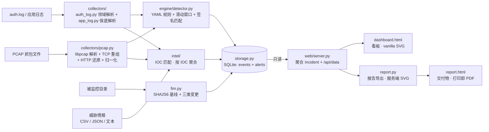

# SentinelWatch — 主机日志审计与入侵检测平台

[](https://github.com/yliucherish/sentinelwatch/actions/workflows/ci.yml)

> 基于 Python 标准库的轻量级入侵检测平台：**日志 + 流量双数据源**——
> 暴力破解检测、文件完整性监控（FIM）、PCAP 流量还原与 HTTP 层攻击检测、
> 告警聚合降噪与可视化看板。
>
> **本工具仅用于分析你有权查看的日志/流量与你自己的主机。未授权部署/监控属违法行为。**

## 核心能力

| 模块 | 能力 | 设计要点（面试可讲） |
|---|---|---|
| 采集解析 | auth.log 领域解析 + 任意应用日志保底解析 + **PCAP 流量还原（v1.2）** | 两层分工：领域解析器给结构化字段（user/ip/port），保底解析器不丢任何行——覆盖率优先，真实 SIEM 采集层的标准分层 |
| 流量检测（v1.2） | 手写 libpcap 解析 → TCP 重组 → HTTP 还原 → 归一化 → 复用规则引擎 | **检测特征与数据源解耦**：三种采集器产出同一种事件模型，规则/存储/看板/报告一行不改就能吃流量。手写 pcap 解析不引 scapy（3 种链路类型、大小端、纳秒精度、乱序重组） |
| Web 攻击检测（v1.5） | SQLi 四类（UNION / 布尔盲注 / 时间盲注 / 元数据探测）、XSS 两类、路径遍历 | **判据按攻击手法组织，不只按漏洞编号组织**：Log4Shell + Fastjson 只是"某两个组件的某两个漏洞"，SQLi/XSS 才是 Web 攻击的常态。判据一律要求明确注入语法（`onerror=alert` 而非裸 `onerror`、`../../` 而非单个 `../`）——**宁可少报，也不要在第一周就被关掉** |
| 规则引擎 | YAML 声明式规则 + 滑动窗口 + 阈值判定 + **签名匹配** | **新增检测场景 = 加一个 YAML 文件，不改代码**；阈值检测抓行为模式（爆破），签名匹配抓已知攻击特征（Log4Shell 载荷）——双模并存，参照 osquery/Wazuh + Suricata 的分工 |
| 规则标准化（v1.3） | ATT&CK 映射（15 条全打标签）+ **Sigma 导出（13/15）** | **判据可被别家消费**：Sigma 是检测规则的通用语，能转就能进 Splunk/Elastic。阈值规则**显式拒绝**而不是降级成 threshold=1（宁可不转，不转错）；覆盖率分母是自声明的检测范围而非全量矩阵——40% 这个数字能解释、能改进 |
| FIM | 目录 SHA256 基线 + added/modified/deleted 检测 | **哈希而非 mtime**（`touch` 可伪造 mtime，伪造不了 SHA256）；基线必须在监控树外（CLI 有防护） |
| 威胁情报（v1.1） | IOC 匹配：IP / CIDR / 域名（含子域）/ 文件哈希 / URL 片段 | **情报与规则分离**：规则描述"行为模式"（相对稳定、要人工调），情报描述"已知恶意实体"（天天变、可直接订阅）。命中**按 IOC 聚合成一条告警 + 命中次数**——一次爆破里同一恶名 IP 出现几十次，不聚合就是几十条重复告警。产出复用 Alert 模型，看板/报告/抑制器**零改动** |
| 告警聚合 | 按 (源 IP, 时间窗) 聚合成 Incident | 告警降噪 + **聚合不丢成员**（可解释性是蓝队工具的公信力基础） |
| Web 看板 | 告警时间线折线图 + TOP 源 IP 柱状图 + Incident 视图 | **零第三方依赖**：stdlib http.server + vanilla SVG；内网/隔离环境可演示 |
| 报告导出 | 一键生成独立 HTML 安全报告（服务端 SVG 图表） | 看板是"实时态势"，报告是"事后交付"——同一份 DB 两种消费形态；`@media print` 打印即存 PDF，不引 reportlab |
| 存储 | SQLite 单文件（events + alerts 双表） | 事件可回溯（"这条告警基于哪些事件"）；(ip, ts) 联合索引支撑窗口查询 |

内置检测规则（`rules/` 目录，全部 YAML 声明式）：

| 规则 | 判据 | 级别 |
|---|---|---|
| SSH 暴力破解 | 阈值：同 IP 5 分钟失败 ≥5 次 | high |
| SSH 用户名枚举 | 阈值：同 IP 5 分钟 Invalid user ≥5 次 | medium |
| Log4Shell JNDI 载荷 | 签名：日志含 `${jndi:`（CVE-2021-44228） | critical |
| Log4Shell 混淆变体 | 签名：`${lower:j` / `${::-j` 等嵌套绕过 | high |
| Log4Shell JNDI 触达 | 签名：`com.sun.jndi.ldap.LdapCtx@` 残留（JNDI 查询已发生） | high |
| Log4Shell 反序列化触达 | 签名：`com.sun.rowset.JdbcRowSetImpl@` 残留（序列化字节流已被还原） | high |
| Fastjson JdbcRowSetImpl 载荷 | 签名：`@type` + `com.sun.rowset.JdbcRowSetImpl` | critical |
| Fastjson autoType 缓存绕过 | 签名：`@type` 指向 `java.lang.Class`（1.2.25–1.2.47） | critical |
| Fastjson expectClass 绕过 | 签名：`@type` 指向 `java.lang.AutoCloseable` | critical |
| Fastjson JNDI 地址兜底 | 签名：输入含 `ldap://` / `rmi://` | high |
| Fastjson JNDI 触发痕迹 | 签名：`set property error, autoCommit`（setter 已触发 connect） | high |
| Fastjson 攻击被模块封装打断 | 签名：`InaccessibleObjectException` + 模块未 opens（Java 9+ 拦截） | medium |
| 流量侧 Log4Shell（v1.2） | 签名：HTTP 请求（归一化后）含 `${jndi:` | critical |
| 流量侧 Fastjson autoType（v1.2） | 签名：body 含 `@type` + 已知利用链类 | critical |
| 流量侧 WebShell 落地（v1.2） | 签名：body 含 `eval($_POST` / `Runtime.exec(` | critical |
| 流量侧 SQLi · UNION 联合查询（v1.5） | 签名：`union select` / `union/**/select` | critical |
| 流量侧 SQLi · 布尔盲注（v1.5） | 签名：`' or ` **且** `=1--` / `='1` / `1=1` | high |
| 流量侧 SQLi · 时间盲注（v1.5） | 签名：`sleep(` / `benchmark(` / `waitfor delay` | high |
| 流量侧 SQLi · 元数据探测（v1.5） | 签名：`information_schema` / `load_file(` / `into outfile` | high |
| 流量侧 XSS · 脚本标签（v1.5） | 签名：`<script` / `<svg onload` / `javascript:alert(` | high |
| 流量侧 XSS · 事件处理器（v1.5） | 签名：`onerror=alert` / `onload=alert` | medium |
| 流量侧 路径遍历（v1.5） | 签名：`../../` / `/etc/passwd` / `..\..\` | high |

> v1.5 这 7 条的来历值得一说：它们是**去量公开数据集时才发现必须补**的。
> CIC-IDS2017 的 Web 攻击是 SQLi / XSS / 表单爆破，而当时 13 条规则全压在
> Log4Shell(2021) / Fastjson / WebShell 上——一条都命中不了。教训是：
> **判据要按攻击手法组织，不能只按漏洞编号组织。** 详见
> [`bench/DATASETS.md`](bench/DATASETS.md)。

## 快速开始

```bash
# 无需安装任何依赖（Python 3.10+；PyYAML 仅规则加载需要）
pip install pyyaml

# 1. 导入日志 → 规则检测 → 告警入库
python cli.py import --log tests/sample_auth.log --db sentinelwatch.db --reset

# 1.5 叠加威胁情报匹配（可选）：命中恶名 IP / 域名 / 哈希 / URL 时产出 IOC-* 告警
python cli.py import --log tests/sample_auth.log --db sentinelwatch.db --reset \
    --iocs tests/sample_intel.csv
# → 规则层抓到"5 次失败登录"，情报层补充"这个 IP 是已知演练网段"，
#   两条告警互补而不是重复；同一 IOC 只产 1 条（命中次数写进 event_count）

# 1.6 流量检测（v1.2）：直接吃 PCAP，与日志进同一张表、同一套规则引擎
python cli.py traffic --pcap tests/fixtures/traffic_demo.pcap --db sentinelwatch.db
# → 8 个包 → 还原 5 条 HTTP 请求 → 3 条 CRITICAL（Log4Shell / Fastjson / WebShell）
#   演示 PCAP 由 tools/pcapgen.py 合成（校验和正确，Wireshark 可直接打开）：
#   python -m tools.pcapgen out.pcap

# 2. 文件完整性监控：先建基线，改动文件后再扫一次
python cli.py fim --dir /path/to/watch --baseline /tmp/fim_baseline.json
#    （修改/新增/删除文件后重复同一命令，即产生 FIM 告警）

# 3. 启动看板（默认仅绑 127.0.0.1）
python cli.py serve --db sentinelwatch.db --port 8080
#    浏览器打开 http://127.0.0.1:8080

# 4. 导出 HTML 告警报告（浏览器 Ctrl+P 可另存为 PDF）
python cli.py report --db sentinelwatch.db --out report.html
```

**应用日志检测示例**（Log4Shell，样本攻击行取自 `cve-research/` 的真实复现捕获）：

```bash
python cli.py import --log tests/sample_app.log --format app --db log4shell.db --reset
# → 2 条 CRITICAL（${jndi: 载荷）+ 2 条 HIGH（JNDI 查找/反序列化残留），正常行静默
```

内置样本：`tests/sample_auth.log`（22 条手工构造事件：暴力突发 / 慢速尝试 /
用户名枚举 / 正常流量 / CRON 脏行）。导入后预期 2 条告警：
**SSH 暴力破解（HIGH，203.0.113.9）** 与 **SSH 用户名枚举（MEDIUM，192.0.2.66）**，
慢速尝试 IP（198.51.100.7，跨 15 分钟 3 次）正确不告警。

报告导出效果见 [`reports/demo_report.html`](reports/demo_report.html)（由样本日志一键生成）。

## 架构与数据链路




**三条采集链路汇进同一个事件表**——这是 v1.2 最重要的结构变化：
日志（`app_log`）、认证日志（`failed_password` 等）、流量（`http_request`）
产出的都是同一组字段的 `Event`，所以规则、存储、看板、报告零改动。
新增数据源的成本从"改五处"降到"加一个采集器 + 一份规则文件"。

**为什么事件与告警分表**：告警必须可解释、可取证——每条告警都能回溯到原始事件。
这是审计类系统的基本要求，也是与"玩具项目"的分水岭。

**为什么聚合与抑制分开**：引擎内的 suppress 解决"同一条规则的重复告警"；
`suppressor.py` 解决"不同规则的关联呈现"（一次暴力破解同时触发暴力破解 +
用户名枚举两条规则，应呈现为一个 Incident 而非两条）。

**为什么看板与报告是两份出口**：看板面向"正在值班的人"（实时、可交互、
按时间倒序）；报告面向"事后复盘/交付"（静态、可打印、按严重度排序）。
同一份 DB、同一套聚合（`report.py` 直接复用 `web/server.py` 的
`build_api_payload`——单一定义源，避免两套聚合各漂各的）。

### 威胁情报层（v1.1 新增）

规则层回答「这个行为像不像攻击」，情报层回答「这个实体是不是已知的坏东西」。
两者是正交判据，所以做成两个模块、产同一种告警。

| IOC 类型 | 匹配方式 |
|---|---|
| `ip` | 精确匹配日志中的 IP 字面量（IPv4 / IPv6） |
| `cidr` | 网段包含判断（`ip in network`） |
| `domain` | **后缀边界匹配**：`a.b.evil.com` 命中 `evil.com`，但 `notevil.com` 不命中 |
| `hash` | MD5(32) / SHA1(40) / SHA256(64)，按长度校验后再比 |
| `url` | 子串包含（用于匹配 C2 落地页路径） |

情报文件支持 CSV / JSON / 纯文本，`kind` 可省略（按值的形态自动推断）：

```csv
value,kind,source,note
45.9.148.37,ip,abuse.ch Feodo,Emotet C2
203.0.113.0/24,cidr,自建,演练网段
```

三个关键决策（都有对应测试）：

1. **按 IOC 聚合**：一次爆破里同一恶名 IP 出现 10 次，只产 1 条告警 +
   `命中次数=10`，窗口覆盖首次到末次命中。不聚合就是 10 条重复告警——
   实测第一次跑出来 12 条告警，8 条是同一个 IOC 重复喊；
2. **复用 Alert 模型**：IOC 告警直接进同一张 `alerts` 表，看板 / HTML 报告 /
   抑制器**零改动**——这是"不重复建模"换来的收益；
3. **误报优先控制**：域名后缀边界、时间格式 `12:34:56` 不当 IPv6、CIDR 严格边界，
   每一条都有独立的真阴性测试（`test_no_false_positive_on_benign_logs`）。

## 流量检测层（v1.2 新增）

### 为什么日志不够

同一场攻击，在日志和流量里留下的痕迹不一样，各有盲区：

| 攻击场景 | 日志侧 | 流量侧 |
|---|---|---|
| Log4Shell 载荷 | 只有应用真的用 log4j 打了这条日志才可见 | 请求头 / URL 里的载荷必现 |
| 被上游 WAF 拦下的请求 | **看不到**（请求没到应用） | 看得到（拦在网络层之前） |
| 日志被截断 / 转义 / 丢弃 | 看不到原文 | 看得到原始字节 |
| WebShell 落地请求 | **看不到**（写入的内容不进日志） | 看得到 POST body |
| 主机行为（爆破、文件篡改） | 看得到 | 看不到 |

所以真实 IDS 是双数据源。本项目把流量也变成**同一种事件模型**：

```
PCAP ──▶ libpcap 解析 ──▶ TCP 重组 ──▶ HTTP 还原 ──▶ 归一化 ──▶ 规则引擎 ──▶ 同一种 Alert
        (3 种链路类型)   (乱序/重传)   (按 Content-Length)  (解码+小写)   (15 条规则)   (看板/报告)
```

### 四个值得讲的设计决策

1. **手写 libpcap / pcapng 解析，不引 scapy**：支持 Ethernet(1) / Raw IP(101) / Linux SLL(113)
   三种链路类型（`tcpdump -i any` 产出的是 SLL，只支持 Ethernet 会直接踩坑）、
   大小端 magic、微秒/纳秒精度、802.1Q VLAN 标签；**pcapng 也原生支持**
   （Section/Interface/Enhanced Packet 块 + `if_tsresol`，按接口记链路类型）。
   最后这条是跑 CIC 数据集逼出来的：官方文件叫 `.pcap`，实际是 pcapng。
   省一个依赖的收益比想象中大——安全工具自身加载第三方库就是供应链攻击面，
   而"先装个 tcpdump 转格式"等于把能不能读文件的前提交给外部工具。
2. **TCP 重组必须处理乱序**：攻击者把载荷拆成两个包本身就是一种绕过。
   实现上"先收齐再按 seq 拼"，而不是边收边吐——因为先到的可能是**后半段**，
   以首包为基准做流式拼接会把前半段永远丢掉（有专门的乱序测试守着）。
3. **判据与证据分离**：每个事件同时带 `raw`（原始字节，取证用）和
   `normalized`（URL 解码到不动点 + 转小写，签名匹配用）。
   `${jndi:` 可以写成 `%24%7Bjndi%3A`（URL 编码）、`${JNDI:`（大小写）、
   甚至双重编码——只对原文匹配，一个 `%24` 就绕过。**判据可以归一化，证据不能改写。**
4. **规则分文件、签名词汇共用**：`log4shell.yaml` 吃 `app_log`，
   `http_traffic.yaml` 吃 `http_request`，但判据是同一套——这就是
   "检测特征不绑定数据源"。新增数据源 = 一个采集器 + 一份规则文件，引擎零改动。

### 已知限制（写在明面上）

| 限制 | 原因 | 影响 |
|---|---|---|
| 只支持未加密 HTTP/1.x | HTTPS 需要密钥/解密代理 | 生产环境大部分流量看不到（真实 IDS 同样要解密方案） |
| 不支持 chunked / gzip body | 按 Content-Length 取体 | 少数 API 会漏（已列 TODO） |
| 不做完整 TCP 状态机 | 离线 PCAP 分析不需要跟踪握手/挥手 | 在线旁路抓包需补状态机 |
| IPv4 only | 未实现 IPv6 解析 | 双栈环境会漏 IPv6 流量 |

**这些限制不是"没做完"，而是"边界说清楚"**——面试官更在意你知不知道自己
方案的能力边界，而不是你有没有把全部功能都写完。

> 与 [BypassLab](https://github.com/yliucherish/bypasslab) 的关系：BypassLab 是
> "造 WAF 并自己打"，本层是"在流量里抓这些攻击"。前者的归一化管道思想
> （解码到不动点再匹配）与这里的 `normalize()` 是同一个判断：
> **绕过与检测的对抗，本质上是"谁先把对方的表示形式规范化"**。

### 公开数据集评测（`bench/`）

自造的 8 包样本能证明代码跑得通，证明不了检测器好不好——**自己出题自己答，
永远满分**。要拿外面的尺子量，所以有 `bench/`：

```bash
python bench/run_benchmark.py --self-test     # 先自检脚本（不需要数据集）
python bench/run_benchmark.py --pcap data/x.pcap \
    --labels bench/labels/cic_ids2017_thursday_web.json --out out/
```

三个指标：**检出率 / 误报率 / 吞吐**，每个都能用命令重跑。标注口径是显式声明的
——数据集按 flow 打标签、本工具按 request 产出事件，所以不用自带标签，改用
「攻击时间窗 + 攻击源 IP」，并把这个口径原样印在报告里让人复核。

**当前状态：周二（11 GB，纯良性语料）已跑完。**

```
11,048,283,608 字节 pcapng，约 1,900 万包，48,345 条 HTTP 请求
误报率 0 / 48,345 = 0.0000%（10 条签名规则全参与判定）
吞吐 96.99 MB/s，单线程全量 113.9 秒
```

周二这一天的攻击是 FTP/SSH 爆破，**没有 HTTP 攻击**，所以它只能给误报率、
给不了检出率——这个限制写在报告和 [`bench/BENCHMARK.md`](bench/BENCHMARK.md)
里，不藏。检出率等周四（Web 攻击段，7.8 GB 待下载）跑出来再填，填假数字
比空着更糟。
[`bench/DATASETS.md`](bench/DATASETS.md)。

**做这件事已经赚到了**：它立刻暴露了一个自造样本永远测不出的 bug——解析器原来
用 `read_bytes()` 把整个文件读进内存，7.7 GB 的 PCAP 第一秒就把进程打死。
已改为流式解析（`iter_events()`，内存上界由活跃流数量决定而非文件大小）。
**换一把尺子才能看见自己的剑有多长**——这跟检出率高低无关。

## ATT&CK 覆盖与 Sigma 导出（v1.3 新增）

### 覆盖率：分母是自己声明的检测范围

说"我覆盖了 ATT&CK"没有信息量——企业矩阵有 200+ 技术，任何单点检测项目的
覆盖率都不到 1%，这个数字既不诚实也无法改进。本项目的分母是**声明的检测
范围**：三个数据源（认证日志 / 应用日志 / HTTP 流量）+ FIM 在原理上能看见的
技术，共 15 条。

| 口径 | 覆盖 | 总数 | 覆盖率 | 看的是什么 |
|---|---|---|---|---|
| 子技术层 | 6 | 15 | **40.0%** | 判据是否细化到子技术 |
| 父技术层 | 5 | 10 | **50.0%** | 攻击场景是否齐全 |

已覆盖：T1110 / T1110.001（爆破）、T1087（账户发现）、T1190（利用公网应用，
12 条规则）、T1059（命令执行）、T1505.003（WebShell）。

未覆盖的 9 条不是"忘了"，每条都写清了缺什么（见
[reports/attack_coverage.md](reports/attack_coverage.md) 的 backlog 表）。其中
**T1087.001 只是标签粒度问题**（能力已有，规则没打子技术标签）；
**T1046 / T1041 / T1071.001 需要新的判据类型**——半开连接统计、出站字节聚合、
beacon 周期方差分析，都不是"再加一条子串规则"能解决的。这两类 gap 性质不同，
混在一起谈就容易自我感动。

```bash
python tools/attack_coverage.py                        # 控制台
python tools/attack_coverage.py --md reports/attack_coverage.md
python tools/attack_coverage.py --json                 # 机器可读
```

覆盖率**从规则文件的 `attack.*` 标签动态统计**，不是手抄的数字：删掉一条规则
的标签，数字立刻下降。这样报告才是活的，也才敢挂进 CI。

### Sigma 导出：让判据能被别家消费

Sigma 是检测规则的"通用语"（类比 YARA 之于文件、Snort 之于流量）。一条规则能
转成 Sigma，就等于能被 Splunk / Elastic / Sentinel / QRadar 等几十个后端直接
消费——这是"检测逻辑能在社区流通"的最低门槛。

```bash
python tools/to_sigma.py                    # → sigma/（13 条）
python tools/to_sigma.py --cased            # 大小写严格等价版本
sigma check sigma/                          # 官方校验器（pip install sigma-cli）
```

**结果：20 条可转、2 条显式拒绝、官方校验 0 error / 0 condition error /
1 个 low 级 issue。**（那 1 个 `EscapedWildcardIssue` 是**故意的**：
`union/**/select` 里的 `*` 要按字面匹配，必须转义，否则 Sigma 会当成通配符——
详见下面第 4 点。）

转换不是格式翻译，而是语义对齐。四处不能糊弄的地方：

1. **阈值规则无法表达**：Sigma 原生没有"时间窗内 N 次"的语法（要靠 SIEM 侧
   correlation）。所以 `ssh-brute-force` / `ssh-user-enumeration` 直接抛
   `NotConvertible` 并说明原因，而**不是**悄悄生成一条 `threshold=1` 的规则
   ——那种规则上线后会刷屏，比没有规则更糟。**宁可不转，不转错。**
2. **AND 必须拆成多个 selection**：Sigma 里同一 key 下的列表是 OR 语义，所以
   `raw_contains`（AND）要拆成 `selection_all_1/2/...` + `all of selection_all_*`，
   而 `raw_contains_any`（OR）用 `1 of selection_any_*`。这是最容易把 AND 写成
   OR 的地方，`test_sigma_export.py` 里有一条**缺一个 AND 字面量必须不命中**的
   用例专门守它。
3. **大小写语义不同**：引擎的 `raw_contains` 是**大小写敏感**的，Sigma 的
   `|contains` 默认不敏感。默认版本因此比源规则宽松，`--cased` 生成
   `|contains|cased` 的严格等价版本。测试断言的是"引擎命中 ⇒ Sigma 必命中"
   （宽松可接受，漏报不可接受），而不是双向相等——这是我在两种口径之间划的线。
4. **通配符必须转义**：Sigma 的 `|contains` 里 `*` 和 `?` 是通配符。规则里那条
   `union/**/select`（注释绕过关键词的经典写法）直接写出去，Sigma 会理解成
   "union/ 任意 /select"，与"字面包含 `/**/`"不是一回事——**这是静默的语义
   漂移，比报错更危险**。所以转换器把 `\` `*` `?` 一律转义（`_escape_literal`），
   生成物里是 `*union/\*\*/select*`。官方校验器为此留了一个 low 级
   `EscapedWildcardIssue` 提醒"确认转义是有意的"——是有意的。

**顺手修掉的两个真实规范细节**（都是被官方校验器抓出来的，不是查文档查到的）：

- `cve.2021.44228` ❌ → `cve.2021-44228` ✅：pySigma 的 CVETagValidator 正则
  是 `^\d+-\d+$`，**CVE tag 用连字符**。一开始 11 条规则全报
  `InvalidPatternTagIssue`。
- `sigma check` 默认会联网拉 MITRE ATT&CK 数据校验 tag 合法性；离线环境加
  `-x attacktag` 跳过这一项，其余校验（语法、condition 引用、字段修饰符）照跑。

## 测试

```bash
pytest tests/ -v     # 168 个用例
```

- `test_engine.py`（8 个）：解析 / 规则加载 / 阈值与窗口边界 / 存储闭环
- `test_fim_suppressor.py`（9 个）：FIM 三类变更 + 排除规则 + 流式哈希正确性；
  抑制器同 IP 聚合 / 超窗拆分 / 严重度取最高 / 主机侧分组 / 排序
- `test_report.py`（10 个）：报告全链路 / XSS 转义（恶意告警字段不得逃逸）/
  服务端 SVG 图表 / 空库降级 / 零外部引用 / 打印适配 / CLI 子命令
- `test_log4shell_rules.py`（11 个）：通用日志解析器（时间戳/IP/保底不丢行）/
  签名匹配算子（AND/OR）/ Log4Shell 四规则端到端检出 / 静默与 IP 归因 / CLI
- `test_fastjson_rules.py`（12 个）：Fastjson 六规则端到端 / 三种绕过手法
  逐行精确断言 / 静默语义（只拿正常业务行跑规则断言零告警）/ IP 归因 / CLI
- `test_ioc.py`（13 个）：五类 IOC 匹配 / 域名后缀边界 / 聚合与命中次数 /
  真阴性（时间戳不当 IPv6 等）
- `test_pcap.py`（21 个）：PCAP 解析（大小端 / 纳秒 / 三种链路类型 / 截断）/
  TCP 乱序重组 / HTTP keep-alive 多条请求 / 服务端响应与 UDP 不产生事件 /
  URL 编码与大小写变形检出 / 正常流量零告警 / 与存储层字段兼容 /
  **流式解析**（与全量路径事件集一致、keep-alive 不丢请求、空闲流回收、
  损坏文件拒绝畸形帧长）
- `test_sigma_export.py`（31 个）：15 条规则 tag 完整性与格式 / 阈值规则必须
  被拒 / AND-OR 映射到 `all of` 与 `1 of` / **转换前后判定逐样本等价**（含
  否定样本，守"缺一个 AND 字面量不许命中"）/ UUID 确定性 / 仓库 `sigma/` 与
  规则同步 / ATT&CK 覆盖数字必须来自标签 / 官方 pySigma 可解析（装了才跑）
- `test_web_attack_rules.py`（45 个）：SQLi 四类（UNION / 布尔盲注 / 时间盲注 /
  元数据探测）、XSS 两类、路径遍历的**真阳性**（含 URL 编码、注释绕过、大小写
  变形），以及 12 条**真阴性**——正常业务请求全规则零命中，专门放了几颗
  擦边球（单独的 `union` 关键词、单个引号、单层 `../`、正文里的 `sleep`）
  守判据收窄边界；端到端跑 PCAP 全链路

**签名匹配（v1.0）判据语义**：`raw_contains` 列表全部子串都要出现（AND，
收窄匹配）；`raw_contains_any` 任一出现即匹配（OR，同族变体）。两种算子
显式区分——安全规则的匹配条件必须可预测，不靠约定俗成。

## 与 Wazuh / osquery 的关系（致敬与差异）

| | SentinelWatch | Wazuh |
|---|---|---|
| 部署 | 单文件 + SQLite，拷贝即用 | Agent + Manager + Elastic 栈 |
| 数据源 | 日志 + FIM + **PCAP 流量**（v1.2，自带解析与 HTTP 还原） | 日志 + 审计 + 漏洞扫描（流量侧通常另接 Suricata/Zeek 的告警） |
| 规则 | YAML 声明式，单目录加载 | XML 规则 + 解码器体系 |
| 实时性 | 文件导入（实时 agent 列为 v1.5） | 实时采集 |
| 定位 | 学习/演示/小规模主机自查 | 生产级企业部署 |

设计思想（基线 + 声明式规则 + 滑动窗口 + 告警聚合）向 osquery 与 Wazuh 致敬，
工程规模刻意保持轻量——**这个项目的目标是"把 SIEM 的核心链路完整讲清楚"，
而不是再造一个 Wazuh**。

## 技术博客

- 《我用 Python 给自己写了个迷你 osquery：主机入侵检测实践》——三个设计决策（双采集器分层、阈值+签名双模、告警聚合）与各自的取舍

见 [`blog/`](blog/) 目录。

## 免责声明

本工具仅供学习交流和授权环境下的安全分析使用。对未授权主机进行日志收集、
文件监控属于违法行为，使用者需自行承担法律责任。
