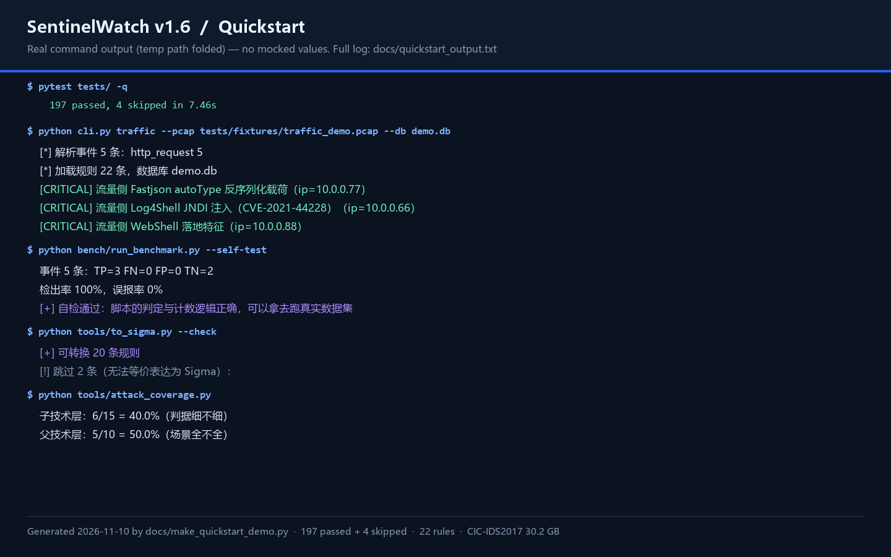
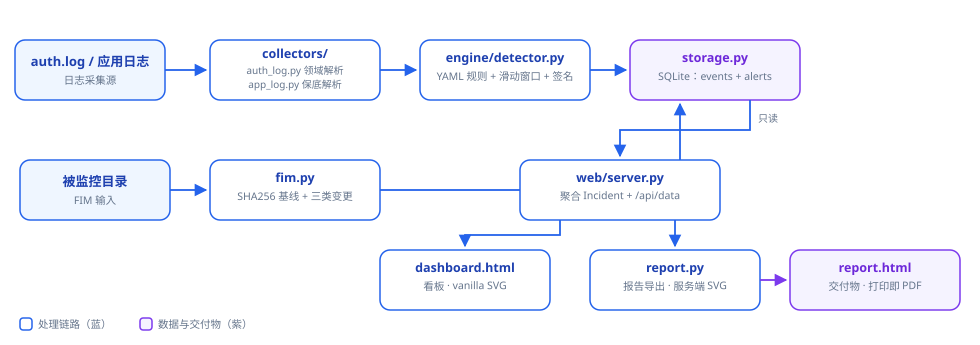
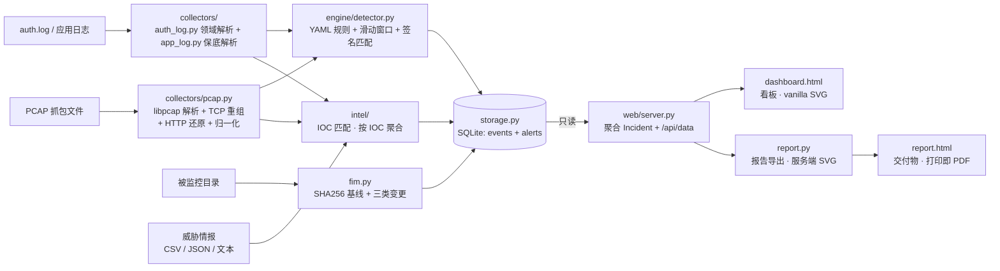

# SentinelWatch — 主机日志审计与入侵检测平台

[](https://github.com/yliucherish/sentinelwatch/actions/workflows/ci.yml)

> 基于 Python 标准库的轻量级入侵检测平台：**日志 + 流量双数据源**——
> 暴力破解检测、文件完整性监控（FIM）、PCAP 流量还原与 HTTP 层攻击检测、
> 告警聚合降噪与可视化看板。
>
> **v2.4（2026-11-15）**：v2.3 说「CRS 判危险词、我们判语法结构」时还只是断言。
> 这一轮把它变成了**一条取舍曲线**——为「参数里只有命令词」这种形态写判据，
> 四个候选、同一套语料：
>
> | 判据形态 | CRS 检出 | 增益 | 真实流量误报 |
> |---|---:|---:|---:|
> | 词表（全量命令名） | 356 | +43 | **80 条** |
> | 词表（只留罕见命令名） | 331 | +18 | **33 条** |
> | **语法（命令名 + 选项/路径）** | **335** | **+22** | **0 条** |
>
> 词表版失败的原因不是词选得不好，是那个边界条件不成立：判据想表达
> 「命令名后面是空白或行尾」，可**请求行自己就以 ` HTTP/1.1` 结尾**，`%2b` 解出的
> `+` 又冒充一次结束——这个条件在 HTTP 里几乎恒成立。换成「命令名后紧跟
> 选项或路径」之后，两个轴同时变好。上线 1 条（规则 30 → 31，Sigma 27 → 28），
> CRS 全量 **313 → 335（16.1% → 17.3%）**，**主矩阵一条没动**：
> 真实误报仍是 **4/150,262**，新判据在真实攻击流量上新增检出 **0**。
> 见 [`BENCHMARK.md`](bench/BENCHMARK.md) §2.14、[`results/cmd_syntax_curve.md`](bench/results/cmd_syntax_curve.md)。
>
> **v2.3（2026-11-14）**：把唯一来自第三方的证据从 **59 条扩到 2,503 条**——
> 不再是手抄 CRS 的四个 libinjection 方法文件，而是把 OWASP CRS 的**全量回归集**
> （148 个规则文件，我们声称的四类）整个转成语料。
>
> 结果 **313/1,940 = 16.1%**，比 59 条时的 54.2% 难看得多，**而难看才是对的**：
> 那 59 条挑的是形状最接近正则的规则。扩量之后有三件事说清楚了——
> ① 排除 CRS 的字符频率计分族后仍是 **16.1%**（又是同一个数），
> **差距不在「我们不做计分模型」**；
> ② **41% 的漏检集中三组规则族**，落到一句话：CRS 判「出现了危险词」，
> 本项目判「出现了注入语法结构」——这是 v2.1 收紧判据换低误报的**账单**；
> ③ 那 563 条「不该触发本规则」的样本**不是良性标签**，里面混着 `pg_sleep(15)`
> 这种真注入，第一版当良性用报出「误报 4.44%」，是个方向指反的指标。
> 见 [`BENCHMARK.md`](bench/BENCHMARK.md) §2.13、[`results/crs_regression.md`](bench/results/crs_regression.md)。
>
> **v2.2（2026-11-14）**：把抓扫描器的判据**换了一个维度**——从「谁在扫」
> （User-Agent，客户端自报的身份，可伪造）换成「扫什么」（`uri` 上的路径，
> 是它实际做了什么）。同一条目标、同一份语料：UA 判据 **80 条误报**，
> 路径判据 **0 条**，命中 8 次全是真探测（`/.git/HEAD` ×4、`/HNAP1` ×4，
> 同一台内网主机）。
> **但它没有上线。** 这 8 条在语料里被标成良性（数据集只标了攻击日的已知
> 攻击窗），上线会让周四 FP 42 → 50、头条「真实误报 4/150,262」→ 12；
> 而**唯一能让数字不变差的办法是把这 8 条改标成攻击**——可这条规则本来就是
> 照着这些路径写的，改标注等于拿尺子当训练集。所以判据与测量留在
> `bench/proposed/`，`rules/` 仍是 30 条，测试守着「没上线」与「没腐烂」。
> 见 [`BENCHMARK.md`](bench/BENCHMARK.md) §2.12。
>
> **v2.1（2026-11-14）**：补上 RCE 与 SSRF 的判据，规则 28 → **30**
> （27 条可转 Sigma）。命令注入的判据不是「出现过 `;id`」，而是
> **四个语法位置**（命令替换 `$( )` / 反引号 / 分隔符 `; && ||` / 管道 `|`）
> 各自后面跟着一个命令名与命令上下文；SSRF 的判据是**「scheme + 主机」这个
> 组合**——光有 `127.0.0.1` 只是文本，加上 `http://` 才构成「让服务器替攻击者
> 去请求」。
> **交叉评测分母从 117 涨到 184**，因此总分 91.5% → **81.5%** 不可直接比
> （新进来的 rce 49 / ssrf 18 本来就比原来那批难）。可比的是同分母四列：
> SQLi 47/50、XSS 26/32、路径遍历 20/20、反序列化 14/15 **一字未动**，
> 说明新判据没有把旧判据挤掉。`rce` **26/49**、`ssrf` **17/18**。
> **误报代价先量后写**：两条新规则在三份全量 150,262 条良性请求上
> **真误报 0**；又因为它们在 159,187 条请求里（含攻击窗）**一次都没命中**，
> §2.3 的逐请求矩阵一个数都没变。
> 扫描器 UA 指纹这一类**写了、测了、故意不默认开**——8/8 命中 vs 全量
> 良性 80 条误报（同一台内网主机的 Nmap NSE），精度 0/80 的规则不该默认开着。
> 见 [`BENCHMARK.md`](bench/BENCHMARK.md) §2.11。
>
> **v2.0（2026-11-14）**：把判据从「枚举写法」改成「描述形状」。原来的
> `http-sqli-union-select` 写着 4 条子串（`union select`、`union/**/select`…），
> 那是「我见过的四个样本」；现在是一条正则
> `un\s*ion\s*(?:all\s+|distinct\s+)?\(?\s*se\s*lect`——表达的是「union 与 select
> 之间允许任意空白/注释」这条 **SQL 语法约束**。同类改动覆盖 SQLi 布尔/报错/堆叠、
> XSS 事件属性、路径遍历、JNDI、fastjson、Java 序列化，规则 23 → **28**
> （25 条可转 Sigma）。
> **跨项目交叉评测 55.6% → 91.5%**（OWASP CRS 子集 12/59 → **27/59**，
> 未参与调参的 holdout 冻结集 7/19 → **11/19**）。
> **先量误报代价，再写规则**：新增 `bench/run_rule_cost.py`，在三份全量
> 150,262 条良性请求上逐规则数命中。结论不是「真误报 0」，而是更该验的那句
> ——**4 条已知误报（`ar.logger.php` 富文本）一条没多**，6 条新规则与 11 条
> 改判据**新增真误报 0**。它当场抓出 `http-java-serialized` 的 8 条误报
> （某 Cookie 里 `ro0ab` 只是 base64 串中间一段），也抓出了自己第一版把 body
> 截断在 1000 字符、把周一 3 条误报算漏的问题——**一个让人安心的假结果**。
> 三份全量重跑：**TP 855 → 857**、FP 42 / TN 47,143 / 真实误报 4 **全都没变**。
> 见 [`BENCHMARK.md`](bench/BENCHMARK.md) §2.10。
>
> **v1.9（2026-11-14）**：修掉 v1.8 定位到的归一化缺口——form 编码里 `+`
> 的语义是空格，`normalize()` 之前不解，于是 `id=1+UNION+SELECT+...` 整类载荷
> 直接绕过。修法只在 query 与 `x-www-form-urlencoded` body 上换 `+`，且必须在
> `unquote()` **之前**（否则 `%2B` 会被误伤），`raw` 一字不动。
> **三份全量重跑**：周四 TP **853 → 855**、FP 42 不变、周一/周二误报不变，
> 整体检出率 9.56% → **9.58%**，带载荷命中 **853/863 → 855/863 = 99.07%**；
> 告警级结果（8 告警 8 TP / 0 FP）一字未变；跨项目交叉评测 **49.6% → 55.6%**。
> 见 [`BENCHMARK.md`](bench/BENCHMARK.md) §2.9。
>
> **v1.8（2026-11-14）**：补**跨项目交叉评测**——拿 [bypasslab](../bypasslab/)
> 的绕过载荷（228 条，含 OWASP CRS 59 条第三方基准）打本项目规则。首次评测得
> **58/117 = 49.6%**，并定位到「`+` 未按 form 编码解码」这个归一化缺口
> （v1.9 修掉后 55.6%，v2.0 改判据后 **91.5%**）。**规则一条没改**，
> 只新增评测脚本与口径守卫测试；见 [`BENCHMARK.md`](bench/BENCHMARK.md) §2.8。
>
> **v1.7（2026-11-10）**：补上「7,181 条表单爆破请求命中 0」这块结构性短板——
> 新增 HTTP 登录频次**窗口判据**，阈值先用周一/周二两个纯良性工作日标定，
> 再用周四全量验证；窗口告警按**告警级**独立评测，不混进逐请求混淆矩阵。
> 当时为 **30 条规则 / 27 条可导出 Sigma**（3 条阈值规则显式拒绝；另有 1 条在 `bench/proposed/`，测过但没上线，见 §2.12），测试
> 当版本 **207 passed + 8 skipped**。见 [`bench/run_frequency.py`](bench/run_frequency.py)
> 与 [`bench/BENCHMARK.md`](bench/BENCHMARK.md) §2.6。
>
> **v1.6（2026-11-09，评测基线）**：在三份 CIC-IDS2017 单日全量抓包
> （30.2 GB、159,187 条 HTTP 请求）上实测，真实误报 **4/150,262**、
> 带载荷攻击命中 **853/863 = 98.84%**、整体检出率 9.56%、精确率 95.31%。
> 这份主矩阵在 v1.7 未改动；**v1.9 / v2.0 因修归一化、改判据重跑后变为
> TP 857 / FN 8,068 / 误报不变**（见 §2.9、§2.10）。数字与复现命令见
> [`bench/BENCHMARK.md`](bench/BENCHMARK.md)，三份报告原文存
> [`bench/results/`](bench/results/)。
>
> **本工具仅用于分析你有权查看的日志/流量与你自己的主机。未授权部署/监控属违法行为。**

## 核心能力

| 模块 | 能力 | 设计要点（面试可讲） |
|---|---|---|
| 采集解析 | auth.log 领域解析 + 任意应用日志保底解析 + **PCAP 流量还原（v1.2）** | 两层分工：领域解析器给结构化字段（user/ip/port），保底解析器不丢任何行——覆盖率优先，真实 SIEM 采集层的标准分层 |
| 流量检测（v1.2） | 手写 libpcap 解析 → TCP 重组 → HTTP 还原 → 归一化 → 复用规则引擎 | **检测特征与数据源解耦**：三种采集器产出同一种事件模型，规则/存储/看板/报告一行不改就能吃流量。手写 pcap 解析不引 scapy（3 种链路类型、大小端、纳秒精度、乱序重组） |
| Web 攻击检测（v1.5 → v2.1） | SQLi 六类（UNION / 布尔 / 时间 / 元数据 / 报错 / 堆叠）、XSS 两类、路径遍历两种、Java 序列化、超长 UTF-8、**命令注入 / SSRF（v2.1）** | **判据描述的是「形状」，不是「写法」**。子串只能枚举见过的样本（`union select`、`union/**/select` 各一条），正则能表达「这类攻击在语法上必须满足什么」——`un/\*\*/ion se/\*\*/lect` 这种没见过的变体照样命中。跨项目评测因此从 49.6% 走到 **91.5%**（v2.0 口径；v2.1 分母扩到 184 后为 81.5%，见下）。判据仍要求明确注入语法（`onerror=alert` 而非裸 `onerror`），**宁可少报，也不要在第一周就被关掉** |
| 命令注入 / SSRF（v2.1） | 四个命令语法位置 + 五类内网主机（元数据 / 环回 / RFC 1918 / 进制变体 / `file:`、`gopher:`） | **判据写「语法位置」而不是「样本」**：`;id`、`|whoami`、`&&cat /etc/passwd`、`$(curl …)`、`` `uname -a` `` 是同一个形状。两处收窄都是被误报逼出来的：**不认 `${…}`**（视频广告的跟踪宏 `${id}`/`${duration}` 与 shell 的 `${var}` 同形，周一 13 条误报），**反引号要前置边界**（竞价 body 的压缩随机字节里成对反引号包两三个字母）。SSRF 必须是「scheme + 主机」——只有 `127.0.0.1` 是文本，`http://127.0.0.1` 才是让服务器去请求 |
| 侦察 / 敏感路径探测（v2.2，**未上线**） | 版本控制目录、不该公开的配置、设备/框架默认后台三类路径 | **判据维度比判据松紧重要**：抓扫描器有两条路——「谁在扫」（UA，自报身份、可伪造）与「扫什么」（路径，实际行为）。同一份语料上 UA 判据 80 条误报、路径判据 0 条。**但没上线**：命中的 8 条被语料标成良性，上线会让「真实误报 4/150,262」变 12，而让数字不变差唯一的手段是改标注——那正是最不该做的事。判据与测量留在 `bench/proposed/`，测试守着它不腐烂（BENCHMARK §2.12） |
| 规则引擎 | YAML 声明式规则 + 滑动窗口 + 阈值判定 + **签名匹配** | **新增检测场景 = 加一个 YAML 文件，不改代码**；阈值检测抓行为模式（爆破），签名匹配抓已知攻击特征（Log4Shell 载荷）——双模并存，参照 osquery/Wazuh + Suricata 的分工 |
| 规则标准化（v1.3 → v2.0） | ATT&CK 映射（**30 条**全打标签）+ **Sigma 导出（27/30）** | **判据可被别家消费**：Sigma 是检测规则的通用语，能转就能进 Splunk/Elastic。3 条窗口阈值规则**显式拒绝**而不是降级成 threshold=1（宁可不转，不转错）；正则判据映射成 `\|re` 且与子串**落在同一个 OR 组**（分成两组再 AND 就会静默不命中）；覆盖率分母是自声明的检测范围而非全量矩阵——**81.5% 这个数字能解释、能改进** |
| 行为型判据（v1.7） | HTTP 登录端点 60s 窗口频次阈值 | **签名看「请求里有什么」，阈值看「同一 IP 做了多少次」**：CIC 周四 7,181 条爆破请求不含任何注入载荷，签名规则必然命中 0，这不是规则不够多而是判据类型缺失。阈值从**纯良性语料**标定，告警级评测与主矩阵分开，见 §2.6 |
| 公开数据集评测（v1.6） | `bench/`：PCAP + 标注 → 逐请求混淆矩阵 + 报告 | **换别人的尺子量自己**：三份 CIC-IDS2017 全量跑完，检出率 / 误报率 / 吞吐三件套，附分母构成与 FP 归因。标注窗按 UTC 解释、事件按本地墙钟渲染，**统一在 epoch 上比较**，四时区子进程回归守着 |
| FIM | 目录 SHA256 基线 + added/modified/deleted 检测 | **哈希而非 mtime**（`touch` 可伪造 mtime，伪造不了 SHA256）；基线必须在监控树外（CLI 有防护） |
| 威胁情报（v1.1） | IOC 匹配：IP / CIDR / 域名（含子域）/ 文件哈希 / URL 片段 | **情报与规则分离**：规则描述"行为模式"（相对稳定、要人工调），情报描述"已知恶意实体"（天天变、可直接订阅）。命中**按 IOC 聚合成一条告警 + 命中次数**——一次爆破里同一恶名 IP 出现几十次，不聚合就是几十条重复告警。产出复用 Alert 模型，看板/报告/抑制器**零改动** |
| 告警聚合 | 按 (源 IP, 时间窗) 聚合成 Incident | 告警降噪 + **聚合不丢成员**（可解释性是蓝队工具的公信力基础） |
| Web 看板 | 告警时间线折线图 + TOP 源 IP 柱状图 + Incident 视图 | **零第三方依赖**：stdlib http.server + vanilla SVG；内网/隔离环境可演示 |
| 报告导出 | 一键生成独立 HTML 安全报告（服务端 SVG 图表） | 看板是"实时态势"，报告是"事后交付"——同一份 DB 两种消费形态；`@media print` 打印即存 PDF，不引 reportlab |
| 存储 | SQLite 单文件（events + alerts 双表） | 事件可回溯（"这条告警基于哪些事件"）；(ip, ts) 联合索引支撑窗口查询 |

内置检测规则（`rules/` 目录，全部 YAML 声明式）：

| 规则 | 判据 | 级别 |
|---|---|---|
| SSH 暴力破解 | 阈值：同 IP 5 分钟失败 ≥5 次 | high |
| SSH 用户名枚举 | 阈值：同 IP 5 分钟 Invalid user ≥5 次 | medium |
| Log4Shell JNDI 载荷 | 签名：日志含 `${jndi:`（CVE-2021-44228） | critical |
| Log4Shell 混淆变体 | 签名：`${lower:j` / `${::-j` 等嵌套绕过 | high |
| Log4Shell JNDI 触达 | 签名：`com.sun.jndi.ldap.LdapCtx@` 残留（JNDI 查询已发生） | high |
| Log4Shell 反序列化触达 | 签名：`com.sun.rowset.JdbcRowSetImpl@` 残留（序列化字节流已被还原） | high |
| Fastjson JdbcRowSetImpl 载荷 | 签名：`@type` + `com.sun.rowset.JdbcRowSetImpl` | critical |
| Fastjson autoType 缓存绕过 | 签名：`@type` 指向 `java.lang.Class`（1.2.25–1.2.47） | critical |
| Fastjson expectClass 绕过 | 签名：`@type` 指向 `java.lang.AutoCloseable` | critical |
| Fastjson JNDI 地址兜底 | 签名：输入含 `ldap://` / `rmi://` | high |
| Fastjson JNDI 触发痕迹 | 签名：`set property error, autoCommit`（setter 已触发 connect） | high |
| Fastjson 攻击被模块封装打断 | 签名：`InaccessibleObjectException` + 模块未 opens（Java 9+ 拦截） | medium |
| 流量侧 Log4Shell（v1.2，v2.0 改形状） | 签名：请求含 `ndi:` + 短填充 + `://`（`${jndi:${lower:l}dap://}` 里 `l` 是查找展开的，字面 `${jndi:` 根本不存在） | critical |
| 流量侧 Fastjson autoType（v1.2，v2.0 改形状） | 签名：`@type` 指向**全限定类名形状**（≥3 段点分），不再是黑名单类名 | critical |
| 流量侧 WebShell 落地（v1.2） | 签名：body 含 `eval($_POST` / `Runtime.exec(` | critical |
| 流量侧 SQLi · UNION 联合查询（v1.5 → v2.0） | 正则：`un\s*ion\s*(?:all\s+\|distinct\s+)?\(?\s*se\s*lect`，在 `sql_view` 上判（注释归一成空白） | critical |
| 流量侧 SQLi · 布尔恒真/恒假（v1.5 → v2.0） | 正则：and/or + 比较式**语法**，任一侧必须是数字或引号串（否则 `?q=red and size=xl` 会误报） | high |
| 流量侧 SQLi · 时间盲注（v1.5） | 签名：`sleep(` / `benchmark(` / `waitfor delay` | high |
| 流量侧 SQLi · 元数据探测（v1.5） | 签名：`information_schema` / `load_file(` / `into outfile` | high |
| 流量侧 SQLi · 报错注入（v2.0） | 签名：`extractvalue(` / `updatexml(` / `procedure analyse` / `concat(0x` | high |
| 流量侧 SQLi · 堆叠查询（v2.0） | 正则：`;\s*(?:drop\|truncate\|alter\|…)` | critical |
| 流量侧 XSS · 脚本标签（v1.5 → v2.0） | 签名：`<script` / `<svg onload` / `javascript:alert(`，外加**任意命名空间前缀**（`<x:script>`） | high |
| 流量侧 XSS · 事件处理器（v1.5 → v2.0） | 正则：标签 + 事件属性 + **执行函数**（`alert` / `eval(` / `document.` / `fetch(`…）。`onerror=alert(1)` 单独出现不是 XSS——它只有落在 HTML 标签上下文里才可执行 | medium |
| 流量侧 路径遍历（v1.5） | 签名：`../../` / `/etc/passwd` / `..\..\` | high |
| 流量侧 路径遍历 · 变形（v2.0） | 正则：`.../`（三点）、`0x2e…0x2f`（十六进制点/斜杠）等三种编码变体 | high |
| 流量侧 Java 序列化流（v2.0） | 正则：base64 魔数 `ro0ab` / 十六进制 `aced0005`，**带 base64 边界**（序列化流总是从值的开头开始——不加边界会在某广告 Cookie 上误报 8 条） | critical |
| 流量侧 超长 UTF-8 编码（v2.0） | 正则：`%c0%af` / `%e0%80%xx` / `%f0%80%80%xx`。RFC 3629 禁止这类编码，**合法浏览器绝不产生**——所以它在 `raw` 上匹配，`unquote()` 会把它解成 U+FFFD，特征在 `normalized` 里就消失了 | high |
| 流量侧 命令注入（v2.1） | 正则：**四个语法位置**——`$(cmd)` 必须闭合、反引号需前置边界、`;`/`&&`/`\|\|` 后接命令名与命令上下文、单管道后接参数或行尾。命令名是 30 项的表（`id`/`whoami`/`cat`/`curl`/`nc`/`bash`…），**不认 `${cmd}`**（广告宏同形，周一 13 条误报） | critical |
| 流量侧 SSRF（v2.1） | 正则：**scheme + 主机**——云元数据（`169.254.169.254`/`100.100.100.200`/`metadata.google.internal`）、环回（`127.x`/短写 `127.1`/`localhost`/`0.0.0.0`/`[::1]`/`[::ffff:127.0.0.1]`）、RFC 1918、进制变体（`2130706433`/`0x7f000001`/`017700000001`）、`file:///`、`gopher://` | high |

> v1.5 这 7 条的来历值得一说：它们是**去量公开数据集时才发现必须补**的。
> CIC-IDS2017 的 Web 攻击是 SQLi / XSS / 表单爆破，而当时 13 条规则全压在
> Log4Shell(2021) / Fastjson / WebShell 上——一条都命中不了。教训是：
> **判据要按攻击手法组织，不能只按漏洞编号组织。** 详见
> [`bench/DATASETS.md`](bench/DATASETS.md)。

## 快速开始

```bash
# 无需安装任何依赖（Python 3.10+；PyYAML 仅规则加载需要）
pip install pyyaml

# 1. 导入日志 → 规则检测 → 告警入库
python cli.py import --log tests/sample_auth.log --db sentinelwatch.db --reset

# 1.5 叠加威胁情报匹配（可选）：命中恶名 IP / 域名 / 哈希 / URL 时产出 IOC-* 告警
python cli.py import --log tests/sample_auth.log --db sentinelwatch.db --reset \
    --iocs tests/sample_intel.csv
# → 规则层抓到"5 次失败登录"，情报层补充"这个 IP 是已知演练网段"，
#   两条告警互补而不是重复；同一 IOC 只产 1 条（命中次数写进 event_count）

# 1.6 流量检测（v1.2）：直接吃 PCAP，与日志进同一张表、同一套规则引擎
python cli.py traffic --pcap tests/fixtures/traffic_demo.pcap --db sentinelwatch.db
# → 8 个包 → 还原 5 条 HTTP 请求 → 3 条 CRITICAL（Log4Shell / Fastjson / WebShell）
#   演示 PCAP 由 tools/pcapgen.py 合成（校验和正确，Wireshark 可直接打开）：
#   python -m tools.pcapgen out.pcap

# 2. 文件完整性监控：先建基线，改动文件后再扫一次
python cli.py fim --dir /path/to/watch --baseline /tmp/fim_baseline.json
#    （修改/新增/删除文件后重复同一命令，即产生 FIM 告警）

# 3. 启动看板（默认仅绑 127.0.0.1）
python cli.py serve --db sentinelwatch.db --port 8080
#    浏览器打开 http://127.0.0.1:8080

# 4. 导出 HTML 告警报告（浏览器 Ctrl+P 可另存为 PDF）
python cli.py report --db sentinelwatch.db --out report.html
```

**30 秒演示**：下图每一行都由
[`docs/make_quickstart_demo.py`](docs/make_quickstart_demo.py) 真实运行五条命令后
抓取 stdout 渲染，没有手抄或伪造的数字；完整未删改的输出存
[`docs/quickstart_output.txt`](docs/quickstart_output.txt)，可逐行复核（图里只把
随机临时路径折叠成 `demo.db`）。重跑一次即可重新生成图。



**应用日志检测示例**（Log4Shell，样本攻击行取自 `cve-research/` 的真实复现捕获）：

```bash
python cli.py import --log tests/sample_app.log --format app --db log4shell.db --reset
# → 2 条 CRITICAL（${jndi: 载荷）+ 2 条 HIGH（JNDI 查找/反序列化残留），正常行静默
```

内置样本：`tests/sample_auth.log`（22 条手工构造事件：暴力突发 / 慢速尝试 /
用户名枚举 / 正常流量 / CRON 脏行）。导入后预期 2 条告警：
**SSH 暴力破解（HIGH，203.0.113.9）** 与 **SSH 用户名枚举（MEDIUM，192.0.2.66）**，
慢速尝试 IP（198.51.100.7，跨 15 分钟 3 次）正确不告警。

报告导出效果见 [`reports/demo_report.html`](reports/demo_report.html)（由样本日志一键生成）。

## 架构与数据链路





**三条采集链路汇进同一个事件表**——这是 v1.2 最重要的结构变化：
日志（`app_log`）、认证日志（`failed_password` 等）、流量（`http_request`）
产出的都是同一组字段的 `Event`，所以规则、存储、看板、报告零改动。
新增数据源的成本从"改五处"降到"加一个采集器 + 一份规则文件"。

**为什么事件与告警分表**：告警必须可解释、可取证——每条告警都能回溯到原始事件。
这是审计类系统的基本要求，也是与"玩具项目"的分水岭。

**为什么聚合与抑制分开**：引擎内的 suppress 解决"同一条规则的重复告警"；
`suppressor.py` 解决"不同规则的关联呈现"（一次暴力破解同时触发暴力破解 +
用户名枚举两条规则，应呈现为一个 Incident 而非两条）。

**为什么看板与报告是两份出口**：看板面向"正在值班的人"（实时、可交互、
按时间倒序）；报告面向"事后复盘/交付"（静态、可打印、按严重度排序）。
同一份 DB、同一套聚合（`report.py` 直接复用 `web/server.py` 的
`build_api_payload`——单一定义源，避免两套聚合各漂各的）。

### 威胁情报层（v1.1 新增）

规则层回答「这个行为像不像攻击」，情报层回答「这个实体是不是已知的坏东西」。
两者是正交判据，所以做成两个模块、产同一种告警。

| IOC 类型 | 匹配方式 |
|---|---|
| `ip` | 精确匹配日志中的 IP 字面量（IPv4 / IPv6） |
| `cidr` | 网段包含判断（`ip in network`） |
| `domain` | **后缀边界匹配**：`a.b.evil.com` 命中 `evil.com`，但 `notevil.com` 不命中 |
| `hash` | MD5(32) / SHA1(40) / SHA256(64)，按长度校验后再比 |
| `url` | 子串包含（用于匹配 C2 落地页路径） |

情报文件支持 CSV / JSON / 纯文本，`kind` 可省略（按值的形态自动推断）：

```csv
value,kind,source,note
45.9.148.37,ip,abuse.ch Feodo,Emotet C2
203.0.113.0/24,cidr,自建,演练网段
```

三个关键决策（都有对应测试）：

1. **按 IOC 聚合**：一次爆破里同一恶名 IP 出现 10 次，只产 1 条告警 +
   `命中次数=10`，窗口覆盖首次到末次命中。不聚合就是 10 条重复告警——
   实测第一次跑出来 12 条告警，8 条是同一个 IOC 重复喊；
2. **复用 Alert 模型**：IOC 告警直接进同一张 `alerts` 表，看板 / HTML 报告 /
   抑制器**零改动**——这是"不重复建模"换来的收益；
3. **误报优先控制**：域名后缀边界、时间格式 `12:34:56` 不当 IPv6、CIDR 严格边界，
   每一条都有独立的真阴性测试（`test_no_false_positive_on_benign_logs`）。

## 流量检测层（v1.2 新增）

### 为什么日志不够

同一场攻击，在日志和流量里留下的痕迹不一样，各有盲区：

| 攻击场景 | 日志侧 | 流量侧 |
|---|---|---|
| Log4Shell 载荷 | 只有应用真的用 log4j 打了这条日志才可见 | 请求头 / URL 里的载荷必现 |
| 被上游 WAF 拦下的请求 | **看不到**（请求没到应用） | 看得到（拦在网络层之前） |
| 日志被截断 / 转义 / 丢弃 | 看不到原文 | 看得到原始字节 |
| WebShell 落地请求 | **看不到**（写入的内容不进日志） | 看得到 POST body |
| 主机行为（爆破、文件篡改） | 看得到 | 看不到 |

所以真实 IDS 是双数据源。本项目把流量也变成**同一种事件模型**：

```
PCAP ──▶ libpcap 解析 ──▶ TCP 重组 ──▶ HTTP 还原 ──▶ 归一化(3 层解码) ──▶ 判据视图 ──▶ 规则引擎 ──▶ 同一种 Alert
        (3 种链路类型)   (乱序/重传)   (按 Content-Length)  (%XX/%uXXXX/&#N;)  (norm/sql_view)  (31 条规则)  (看板/报告)
```

### 四个值得讲的设计决策

1. **手写 libpcap / pcapng 解析，不引 scapy**：支持 Ethernet(1) / Raw IP(101) / Linux SLL(113)
   三种链路类型（`tcpdump -i any` 产出的是 SLL，只支持 Ethernet 会直接踩坑）、
   大小端 magic、微秒/纳秒精度、802.1Q VLAN 标签；**pcapng 也原生支持**
   （Section/Interface/Enhanced Packet 块 + `if_tsresol`，按接口记链路类型）。
   最后这条是跑 CIC 数据集逼出来的：官方文件叫 `.pcap`，实际是 pcapng。
   省一个依赖的收益比想象中大——安全工具自身加载第三方库就是供应链攻击面，
   而"先装个 tcpdump 转格式"等于把能不能读文件的前提交给外部工具。
2. **TCP 重组必须处理乱序**：攻击者把载荷拆成两个包本身就是一种绕过。
   实现上"先收齐再按 seq 拼"，而不是边收边吐——因为先到的可能是**后半段**，
   以首包为基准做流式拼接会把前半段永远丢掉（有专门的乱序测试守着）。
3. **判据与证据分离**：每个事件同时带 `raw`（原始字节，取证用）和
   `normalized`（URL 解码到不动点 + 转小写，签名匹配用）。
   `${jndi:` 可以写成 `%24%7Bjndi%3A`（URL 编码）、`${JNDI:`（大小写）、
   甚至双重编码——只对原文匹配，一个 `%24` 就绕过。**判据可以归一化，证据不能改写。**
4. **规则分文件、签名词汇共用**：`log4shell.yaml` 吃 `app_log`，
   `http_traffic.yaml` 吃 `http_request`，但判据是同一套——这就是
   "检测特征不绑定数据源"。新增数据源 = 一个采集器 + 一份规则文件，引擎零改动。

### 已知限制（写在明面上）

| 限制 | 原因 | 影响 |
|---|---|---|
| 只支持未加密 HTTP/1.x | HTTPS 需要密钥/解密代理 | 生产环境大部分流量看不到（真实 IDS 同样要解密方案） |
| 不支持 chunked / gzip body | 按 Content-Length 取体 | 少数 API 会漏（已列 TODO） |
| 不做完整 TCP 状态机 | 离线 PCAP 分析不需要跟踪握手/挥手 | 在线旁路抓包需补状态机 |
| IPv4 only | 未实现 IPv6 解析 | 双栈环境会漏 IPv6 流量 |

**这些限制不是"没做完"，而是"边界说清楚"**——面试官更在意你知不知道自己
方案的能力边界，而不是你有没有把全部功能都写完。

> 与 [BypassLab](https://github.com/yliucherish/bypasslab) 的关系：BypassLab 是
> "造 WAF 并自己打"，本层是"在流量里抓这些攻击"。前者的归一化管道思想
> （解码到不动点再匹配）与这里的 `normalize()` 是同一个判断：
> **绕过与检测的对抗，本质上是"谁先把对方的表示形式规范化"**。

### 公开数据集评测（`bench/`）

自造的 8 包样本能证明代码跑得通，证明不了检测器好不好——**自己出题自己答，
永远满分**。要拿外面的尺子量，所以有 `bench/`：

```bash
python bench/run_benchmark.py --self-test     # 先自检脚本（不需要数据集）
python bench/run_benchmark.py --pcap data/x.pcap \
    --labels bench/labels/cic_ids2017_thursday_web.json --out out/
```

三个指标：**检出率 / 误报率 / 吞吐**，每个都能用命令重跑。标注口径是显式声明的
——数据集按 flow 打标签、本工具按 request 产出事件，所以不用自带标签，改用
「攻击时间窗 + 攻击源 IP」，并把这个口径原样印在报告里让人复核。

**当前状态：三份 CIC-IDS2017 单日全量抓包已跑完**（周一 / 周二 / 周四，
30.2 GB、159,187 条 HTTP 请求）。逐请求明细在 `out/bench_*.csv`，全部结论与
复现命令见 [`bench/BENCHMARK.md`](bench/BENCHMARK.md)。

| 指标 | 实测（v2.4） |
|---|---|
| 真实误报 | **4 / 150,262 条良性请求（0.0027%）** |
| 周四带载荷的攻击请求 | **857 / 863 = 99.30% 命中** |
| 整体检出率 | **9.60%**（857/8,925）——分母含 8,062 条无载荷请求，见下 |
| 精确率 | **95.33%** |
| 跨项目交叉评测（专门为绕过构造的载荷） | **150/184 = 81.5%**（v2.1 分母；v2.0 同口径 107/117 = 91.5%），OWASP CRS 子集 **32/59** |
| **第三方基准全量**（OWASP CRS 回归集 2,503 条，v2.4） | **335/1,940 = 17.3%**（SQLi 20.3% / XSS 20.1% / 路径遍历 25.4% / 命令注入 12.5%），零命中规则族 **86/148**；归因：**41% 的漏检来自「CRS 判危险词 vs 我们判注入语法结构」这一项取舍** |
| 吞吐 | 60–97 MB/s（单线程，重复跑有波动，不挑最好看的那次） |

**9.60% 需要解释，否则会被误读。** 标注口径把「攻击机在攻击时段发出的每一次
HTTP 请求」都算成应检出，而其中 8,062 条是 `POST /dv/login.php` 的凭据爆破和
**连 query 都没有**的空 `GET /xss_r/`——签名检测按设计只对载荷告警。按纯语法
判据（URI 有无非空 query，与规则无关）分层后，带载荷那 863 条命中 857 条。
分层表**不替换**主指标，只解释主指标；两个数都印在报告里。

**局限也写在报告里，不藏**：① 7,181 条表单爆破**逐请求命中 0**——签名看不出
「同一 IP 五分钟试了 500 个账号」（v1.7 已用频次窗口判据补上：8 条窗口告警
8 TP / 0 FP，但那属于告警级指标，不摊进逐请求矩阵）；② 4 条真误报全是
`POST /ar.logger.php` 的广告竞价日志，URL 编码的广告素材 HTML 里带 `<script>`
——**不归一化会漏编码绕过，归一化就会把合法富文本看成攻击**，给这个 URI
加白名单只是把数据集背下来，所以没修；③ 只还原 HTTP，周二的 FTP/SSH 爆破
一个事件都没有，那是数据源覆盖范围，换个采集器就抓得到。

跑真实数据赚到的不只是数字：它逼出了「解析器把整个文件读进内存」「官方
`.pcap` 其实是 pcapng」「明细 CSV 攒在内存里」「标注窗是 UTC、事件是本地墙钟」
四个自造样本永远测不出的 bug。最后一个最隐蔽——周四首跑 `TP 0 FN 0`，
看起来像检测器完全没用，实际是时区差 8 小时，894 次真命中全被记成误报。
修法不是把偏移改成本机时区，而是统一在 epoch 上比较，并有四时区的子进程测试守着。
**换一把尺子才能看见自己的剑有多长。**

数据获取与标注口径的三次实测修正（ADT≠EDT、NAT 后攻击源 IP、epoch 比较）见
[`bench/DATASETS.md`](bench/DATASETS.md)。

## ATT&CK 覆盖与 Sigma 导出（v1.3 新增）

### 覆盖率：分母是自己声明的检测范围

说"我覆盖了 ATT&CK"没有信息量——企业矩阵有 200+ 技术，任何单点检测项目的
覆盖率都不到 1%，这个数字既不诚实也无法改进。本项目的分母是**声明的检测
范围**：三个数据源（认证日志 / 应用日志 / HTTP 流量）+ FIM 在原理上能看见的
技术，共 15 条。

| 口径 | 覆盖 | 总数 | 覆盖率 | 看的是什么 |
|---|---|---|---|---|
| 子技术层 | 6 | 15 | **40.0%** | 判据是否细化到子技术 |
| 父技术层 | 5 | 10 | **50.0%** | 攻击场景是否齐全 |

已覆盖：T1110 / T1110.001（爆破）、T1087（账户发现）、T1190（利用公网应用，
12 条规则）、T1059（命令执行）、T1505.003（WebShell）。

未覆盖的 9 条不是"忘了"，每条都写清了缺什么（见
[reports/attack_coverage.md](reports/attack_coverage.md) 的 backlog 表）。其中
**T1087.001 只是标签粒度问题**（能力已有，规则没打子技术标签）；
**T1046 / T1041 / T1071.001 需要新的判据类型**——半开连接统计、出站字节聚合、
beacon 周期方差分析，都不是"再加一条子串规则"能解决的。这两类 gap 性质不同，
混在一起谈就容易自我感动。

```bash
python tools/attack_coverage.py                        # 控制台
python tools/attack_coverage.py --md reports/attack_coverage.md
python tools/attack_coverage.py --json                 # 机器可读
```

覆盖率**从规则文件的 `attack.*` 标签动态统计**，不是手抄的数字：删掉一条规则
的标签，数字立刻下降。这样报告才是活的，也才敢挂进 CI。

### Sigma 导出：让判据能被别家消费

Sigma 是检测规则的"通用语"（类比 YARA 之于文件、Snort 之于流量）。一条规则能
转成 Sigma，就等于能被 Splunk / Elastic / Sentinel / QRadar 等几十个后端直接
消费——这是"检测逻辑能在社区流通"的最低门槛。

```bash
python tools/to_sigma.py                    # → sigma/（28 条）
python tools/to_sigma.py --check           # 只核对可转 / 显式拒绝清单，不写文件
python tools/to_sigma.py --cased           # 大小写严格等价版本
sigma check sigma/                          # 官方校验器（pip install sigma-cli）
```

**结果：28 条可转、3 条显式拒绝（2 条 SSH 阈值 + 1 条 HTTP 频次）。**
（v2.0 之前这里还有 1 个 low 级 `EscapedWildcardIssue`——那是 `union/**/select`
这条字面子串里的 `*` 必须转义。v2.0 把它换成正则之后，仓库里已没有含 `*`/`?`
的字面判据，这个 issue 也随之消失；转换器里的转义逻辑仍然保留，作为防御。）

转换不是格式翻译，而是语义对齐。四处不能糊弄的地方：

1. **阈值规则无法表达**：Sigma 原生没有"时间窗内 N 次"的语法（要靠 SIEM 侧
   correlation）。所以 `ssh-brute-force` / `ssh-user-enumeration` 直接抛
   `NotConvertible` 并说明原因，而**不是**悄悄生成一条 `threshold=1` 的规则
   ——那种规则上线后会刷屏，比没有规则更糟。**宁可不转，不转错。**
2. **AND 必须拆成多个 selection**：Sigma 里同一 key 下的列表是 OR 语义，所以
   `raw_contains`（AND）要拆成 `selection_all_1/2/...` + `all of selection_all_*`，
   而 `raw_contains_any`（OR）用 `1 of selection_any_*`。这是最容易把 AND 写成
   OR 的地方，`test_sigma_export.py` 里有一条**缺一个 AND 字面量必须不命中**的
   用例专门守它。
3. **正则必须与子串同组**（v2.0 新增）：引擎里 `raw_regex` 和 `raw_contains_any`
   是**同一个 OR 组**。导出侧如果把它们分成两个 `selection_any_*` 再 `all of`，
   就复现了引擎侧踩过的坑——规则变成「必须同时命中子串和正则」，几乎永不触发，
   **而它表现为「误报降到 0」，看起来像好消息**。`test_sigma_export.py` 用 9 个
   参数化样本逐条断言「引擎判定 == Sigma 判定」。
4. **大小写语义不同**：引擎的 `raw_contains` 是**大小写敏感**的，Sigma 的
   `|contains` 默认不敏感。默认版本因此比源规则宽松，`--cased` 生成
   `|contains|cased` 的严格等价版本。测试断言的是"引擎命中 ⇒ Sigma 必命中"
   （宽松可接受，漏报不可接受），而不是双向相等——这是我在两种口径之间划的线。
   正则判据则相反：`normalized` / `sql_view` 已是小写，导出必须补 `(?i)`，
   否则在保留大小写的真实字段（如 `cs-uri-query`）上会漏报。

**还有一处必须写在文件里**：源规则检查**整个请求**（请求行 + 全部头部 + body），
Sigma 的一个字段只能对一个变量。所以 `matched_on != "raw"` 的规则，导出文件
头部会带一条**覆盖面差异警告**——不写就是在暗示两边等价。

**顺手修掉的两个真实规范细节**（都是被官方校验器抓出来的，不是查文档查到的）：

- `cve.2021.44228` ❌ → `cve.2021-44228` ✅：pySigma 的 CVETagValidator 正则
  是 `^\d+-\d+$`，**CVE tag 用连字符**。一开始 11 条规则全报
  `InvalidPatternTagIssue`。
- `sigma check` 运行时会联网拉 **MITRE ATT&CK 数据 + 4 个 SigmaHQ JSON**
  （filename / taxonomy / windows_eventid / windows_provider）校验 tag 与字段名，
  任一 URL 失败会**直接抛 RuntimeError 让 job 崩掉**，而不是报一条 issue——
  2026-11-09 修 SigmaHQ PR #6561 时实测到的。离线环境除了 `-x attacktag`，
  还要给 `~/.cache/pysigma/mitre_attack` 与 `~/.cache/pysigma/sigmahq` 预置缓存。

## 测试

```bash
pytest tests/ -q
# 435 passed, 8 skipped（共 443 条 collected；耗时随机器波动）
# 上面是 Windows 本机口径：7 条 skipped 是「平台忽略 TZ、时区子进程无效」，
# 在 Linux / CI 上会真实执行并计入 passed；另 1 条是可选依赖 sigma 未安装。
```

| 测试文件 | 用例 | 守什么 |
|---|---:|---|
| `test_engine.py` | 9 | 规则加载 / 阈值与窗口边界 / 存储闭环 |
| `test_fim_suppressor.py` | 8 | FIM 三类变更 + 排除规则 + 流式哈希 / 抑制器聚合与超窗拆分 |
| `test_report.py` | 9 | 报告全链路 / XSS 转义 / 服务端 SVG / 空库降级 / 打印适配 |
| `test_log4shell_rules.py` | 12 | 通用日志解析器 / AND-OR 算子 / 四规则端到端检出 / 静默与 IP 归因 |
| `test_fastjson_rules.py` | 12 | Fastjson 六规则 / 三种绕过手法逐行断言 / 静默语义 / IP 归因 |
| `test_ioc.py` | 21 | 五类 IOC / 域名后缀边界 / 聚合命中次数 / 真阴性（时间戳不当 IPv6 等） |
| `test_pcap.py` | 37 | 大小端 / 纳秒精度 / 三种链路类型 / **pcapng 原生解析与 `if_tsresol`** / TCP 乱序重组 / keep-alive 多请求 / **流式解析与全量事件集一致** / **v1.9 form `+` 解码三约束** / **v2.0 `%uXXXX` 与数字实体解码（含命名实体不解的反面断言）** / **`sql_view` 只归一判据、不动证据** |
| `test_match_operators.py` | 8 | **引擎语义**（不守某条规则）：正则与子串同属一个 OR 组 / `raw_contains` 是 AND 组 / 两组组合 / `field` 真的切视图 / 非法正则、未知字段、未知操作符、无操作符一律在**加载期**抛错 |
| `test_sigma_export.py` | 43 | **31 条**规则 tag 完整性 / 阈值规则必须被拒 / AND-OR 映射到 `all of` 与 `1 of` / 正则用 `\|re` 且与子串同组 / **引擎与 Sigma 逐样本判定一致（9 个样本）** / 转换前后等价 / UUID 确定性 / 官方 pySigma 可解析 |
| `test_web_attack_rules.py` | 84 | SQLi 六类 / XSS 两类 / 路径遍历两种 / 编码绕过 / JNDI 混淆 / 反序列化 —— 每类都带**同族变体**参数化用例（分隔符 6 种、恒真式 6 种、命名空间标签 5 种…）+ 擦边球真阴性 / 端到端 PCAP / **已记录的误报是正面断言，不是被删掉的用例** |
| `test_bench_selftest.py` | 7 | 评测脚本四时区子进程回归（UTC / 上海 / 纽约 / 柏林） |
| `test_bench_labels.py` | 18 | 标注里的「配置」其实是实测结论：ADT 偏移 3、NAT 后攻击源 IP、epoch 比较、窗 + IP 双条件、`by_shape` 分层、recall 上界 |
| `test_frequency.py` | 13 | 频次规则选择 / 滑动窗口闭区间 / 告警级 TP-FP / 全良性语料告警必记 FP / 阈值以上峰值不告警 / **四时区窗口相交** |
| `test_crosscheck.py` | 10 | 跨项目评测口径：**未声明类别不进分母** / **rce/ssrf 自 v2.1 起必须计入分母且真被命中** / scanner 是攻击样本不是良性 / UA 载荷必须进 raw / **form `+` 编码必须被解码** / **`%2B` 字面加号不能被误伤** / holdout 明细不外泄 / 报告不含本机绝对路径 |
| `test_rule_cost.py` | 6 | **误报代价工具自己的口径**：缓存必须存**完整** body（v2.0 曾截断在 1000 字符，导致长 body 里的载荷数不到、报出「真误报 0」）/ 重建事件必须仍被生产判据命中 / UA 里的载荷必须进判据视图 / 原料字段齐全 |
| `test_rce_ssrf_rules.py` | 90 | 命令注入**四个语法位置**各 3–4 种变体（含 URL 编码、POST form body）+ 良性对照（广告宏 `${id}`、`sort=name|id`、`;jsessionid=`、未闭合的 `$(id`、竞价随机字节里的成对反引号）/ **v2.4 的第五个语法位置「参数值即命令行」**：12 条正例（含基准里没有的变体）+ 8 条反面用例，其中两条钉住这轮查出来的机制——`=source+` 后面是 `Sans`（不是选项/路径）、`&et=ping HTTP/1.1` 里的空格是**协议分隔符**而不是「命令名到此结束」；另加「两条规则不重叠」「子命令形态是已知缺口」「搜索命令行示例会命中，是已知边界」三条边界断言 / SSRF 五类主机（含 `127.1`、`[::ffff:127.0.0.1]`、进制变体）+ 良性对照（只有主机没有 scheme、`172.32` 在 RFC 1918 之外）/ **混合进制 `0x7f.1` 是记下来的缺口，用断言守住** / **扫描器 UA 规则不得上线，`COVERAGE["scanner"]` 的理由必须带 0/80** / **三个被否掉的命令注入候选判据不得进 `rules/`** |
| `test_crs_corpus.py` | 25 | **第三方语料落进仓库后的两个失效方式**（都不会报错）：① 被手改（117 万字符的 JSON 改一条 `is_attack`，17.3% 会安静地变成 17.5%）；② 口径写反（`no_expect_ids` 当良性用，报出方向指反的「误报 4.44%」）。守数据完整性（计数自洽 / id 唯一 / 类别都在 `COVERAGE` 里 / 每条规则都有上游 `msg` / 记了 commit）与口径不变式（`no_expect` 永不进检出率分母 / `known_fp` 桶里必须真有攻击样本 / 异常字符族标记不能丢），外加导入器纯函数（`_split_uri` / `_as_text` / 四桶分类） |
| `test_proposed_rules.py` | 31 | **`bench/proposed/` 的决策守卫**：不加载的规则必须真的没进 `rules/`（防「顺手 git mv」）/ 16 个探测路径必须仍命中、10 个良性路径必须不命中（防「不跑了就慢慢腐烂」）/ `(?i)` 大小写无关（`uri` 视图不转小写）/ **判据只看 `uri`**——博客正文里提到 `/.git/HEAD` 不算探测 |

**时区回归必须含非 UTC**：标注窗按 UTC 解释，事件时间戳是采集器用本地
`datetime.fromtimestamp()` 渲染的 naive datetime，两边统一在 epoch 上比较。
这个 bug 出现过两次（CI 上 TP=0、真实数据集首跑 `TP 0 FN 0 FP 895`），在 UTC
机器上恰好能过，所以四个时区的子进程测试是硬要求，不是锦上添花。

**签名匹配判据语义**（v1.0 起，v2.0 扩到三个算子）：`raw_contains` 列表全部
子串都要出现（**AND 组**，收窄匹配）；`raw_contains_any` 与 `raw_regex`
合起来算**同一个 OR 组**，任一命中即匹配（同族变体）。三个算子显式区分——
安全规则的匹配条件必须可预测，不靠约定俗成。

> **OR 组这条语义踩过坑，值得单独说。** v2.0 最初把 `raw_regex` 实现成独立
> 的 AND 组，给 XSS 规则加「命名空间标签」正则之后，规则变成「必须同时出现
> `<script` 和 `<x:script>`」——**几乎永不命中**。而它在评测里的表现是
> **误报从 1 降到 0**，看起来像好消息。安全规则最危险的失效不是报错，是
> 「看起来在工作、其实不再匹配」：报错会有人修，静默失效只会让人以为
> 「这条规则很准，从来不误报」。现在有两道保险：引擎侧
> `test_regex_and_substring_share_one_or_group`，导出侧「正则与子串必须同组」。

判据从哪个视图上匹配由 `match.field` 决定，可用的是 `raw`（原始证据）、
`normalized`（URL 解码到不动点 + 转小写）、`sql_view`（再去掉 SQL 注释与空白
噪声）、`uri` / `body` / `method` / `host`。**字段名写错在加载期就抛错**，
不会静默退化成「从不命中」。

## 与 Wazuh / osquery 的关系（致敬与差异）

| | SentinelWatch | Wazuh |
|---|---|---|
| 部署 | 单文件 + SQLite，拷贝即用 | Agent + Manager + Elastic 栈 |
| 数据源 | 日志 + FIM + **PCAP 流量**（v1.2，自带解析与 HTTP 还原） | 日志 + 审计 + 漏洞扫描（流量侧通常另接 Suricata/Zeek 的告警） |
| 规则 | YAML 声明式，单目录加载 | XML 规则 + 解码器体系 |
| 实时性 | 离线文件导入 + PCAP 批处理（无在线 agent） | 实时采集 |
| 定位 | 学习/演示/小规模主机自查 | 生产级企业部署 |

设计思想（基线 + 声明式规则 + 滑动窗口 + 告警聚合）向 osquery 与 Wazuh 致敬，
工程规模刻意保持轻量——**这个项目的目标是"把 SIEM 的核心链路完整讲清楚"，
而不是再造一个 Wazuh**。

## 技术博客

- 《我用 Python 给自己写了个迷你 osquery：主机入侵检测实践》——三个设计决策（双采集器分层、阈值+签名双模、告警聚合）与各自的取舍

见 [`blog/`](blog/) 目录。

## 免责声明

本工具仅供学习交流和授权环境下的安全分析使用。对未授权主机进行日志收集、
文件监控属于违法行为，使用者需自行承担法律责任。
