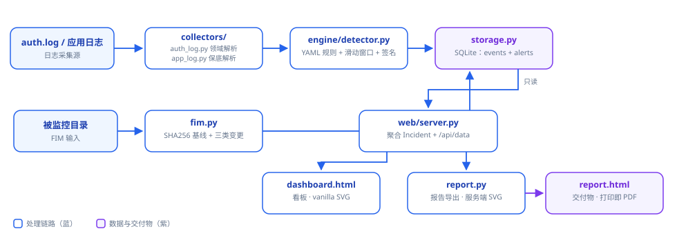
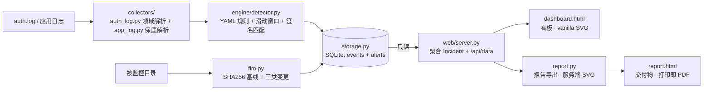

# SentinelWatch — 主机日志审计与入侵检测平台

[](https://github.com/yliucherish/sentinelwatch/actions/workflows/ci.yml)

> 基于 Python 标准库的轻量级主机入侵检测与日志审计平台：暴力破解检测、
> 文件完整性监控（FIM）、告警聚合降噪与可视化看板。
>
> **本工具仅用于分析你有权查看的日志与你自己的主机。未授权部署/监控属违法行为。**

## 核心能力

| 模块 | 能力 | 设计要点（面试可讲） |
|---|---|---|
| 采集解析 | auth.log 领域解析 + 任意应用日志保底解析 | 两层分工：领域解析器给结构化字段（user/ip/port），保底解析器不丢任何行——覆盖率优先，真实 SIEM 采集层的标准分层 |
| 规则引擎 | YAML 声明式规则 + 滑动窗口 + 阈值判定 + **签名匹配** | **新增检测场景 = 加一个 YAML 文件，不改代码**；阈值检测抓行为模式（爆破），签名匹配抓已知攻击特征（Log4Shell 载荷）——双模并存，参照 osquery/Wazuh + Suricata 的分工 |
| FIM | 目录 SHA256 基线 + added/modified/deleted 检测 | **哈希而非 mtime**（`touch` 可伪造 mtime，伪造不了 SHA256）；基线必须在监控树外（CLI 有防护） |
| 告警聚合 | 按 (源 IP, 时间窗) 聚合成 Incident | 告警降噪 + **聚合不丢成员**（可解释性是蓝队工具的公信力基础） |
| Web 看板 | 告警时间线折线图 + TOP 源 IP 柱状图 + Incident 视图 | **零第三方依赖**：stdlib http.server + vanilla SVG；内网/隔离环境可演示 |
| 报告导出 | 一键生成独立 HTML 安全报告（服务端 SVG 图表） | 看板是"实时态势"，报告是"事后交付"——同一份 DB 两种消费形态；`@media print` 打印即存 PDF，不引 reportlab |
| 存储 | SQLite 单文件（events + alerts 双表） | 事件可回溯（"这条告警基于哪些事件"）；(ip, ts) 联合索引支撑窗口查询 |

内置检测规则（`rules/` 目录，全部 YAML 声明式）：

| 规则 | 判据 | 级别 |
|---|---|---|
| SSH 暴力破解 | 阈值：同 IP 5 分钟失败 ≥5 次 | high |
| SSH 用户名枚举 | 阈值：同 IP 5 分钟 Invalid user ≥5 次 | medium |
| Log4Shell JNDI 载荷 | 签名：日志含 `${jndi:`（CVE-2021-44228） | critical |
| Log4Shell 混淆变体 | 签名：`${lower:j` / `${::-j` 等嵌套绕过 | high |
| Log4Shell JNDI 触达 | 签名：`com.sun.jndi.ldap.LdapCtx@` 残留（JNDI 查询已发生） | high |
| Log4Shell 反序列化触达 | 签名：`com.sun.rowset.JdbcRowSetImpl@` 残留（序列化字节流已被还原） | high |

## 快速开始

```bash
# 无需安装任何依赖（Python 3.10+；PyYAML 仅规则加载需要）
pip install pyyaml

# 1. 导入日志 → 规则检测 → 告警入库
python cli.py import --log tests/sample_auth.log --db sentinelwatch.db --reset

# 2. 文件完整性监控：先建基线，改动文件后再扫一次
python cli.py fim --dir /path/to/watch --baseline /tmp/fim_baseline.json
#    （修改/新增/删除文件后重复同一命令，即产生 FIM 告警）

# 3. 启动看板（默认仅绑 127.0.0.1）
python cli.py serve --db sentinelwatch.db --port 8080
#    浏览器打开 http://127.0.0.1:8080

# 4. 导出 HTML 告警报告（浏览器 Ctrl+P 可另存为 PDF）
python cli.py report --db sentinelwatch.db --out report.html
```

**应用日志检测示例**（Log4Shell，样本攻击行取自 `cve-research/` 的真实复现捕获）：

```bash
python cli.py import --log tests/sample_app.log --format app --db log4shell.db --reset
# → 2 条 CRITICAL（${jndi: 载荷）+ 2 条 HIGH（JNDI 查找/反序列化残留），正常行静默
```

内置样本：`tests/sample_auth.log`（22 条手工构造事件：暴力突发 / 慢速尝试 /
用户名枚举 / 正常流量 / CRON 脏行）。导入后预期 2 条告警：
**SSH 暴力破解（HIGH，203.0.113.9）** 与 **SSH 用户名枚举（MEDIUM，192.0.2.66）**，
慢速尝试 IP（198.51.100.7，跨 15 分钟 3 次）正确不告警。

报告导出效果见 [`reports/demo_report.html`](reports/demo_report.html)（由样本日志一键生成）。

## 架构与数据链路





**为什么事件与告警分表**：告警必须可解释、可取证——每条告警都能回溯到原始事件。
这是审计类系统的基本要求，也是与"玩具项目"的分水岭。

**为什么聚合与抑制分开**：引擎内的 suppress 解决"同一条规则的重复告警"；
`suppressor.py` 解决"不同规则的关联呈现"（一次暴力破解同时触发暴力破解 +
用户名枚举两条规则，应呈现为一个 Incident 而非两条）。

**为什么看板与报告是两份出口**：看板面向"正在值班的人"（实时、可交互、
按时间倒序）；报告面向"事后复盘/交付"（静态、可打印、按严重度排序）。
同一份 DB、同一套聚合（`report.py` 直接复用 `web/server.py` 的
`build_api_payload`——单一定义源，避免两套聚合各漂各的）。

## 测试

```bash
pytest tests/ -v     # 50 个用例
```

- `test_engine.py`（8 个）：解析 / 规则加载 / 阈值与窗口边界 / 存储闭环
- `test_fim_suppressor.py`（9 个）：FIM 三类变更 + 排除规则 + 流式哈希正确性；
  抑制器同 IP 聚合 / 超窗拆分 / 严重度取最高 / 主机侧分组 / 排序
- `test_report.py`（10 个）：报告全链路 / XSS 转义（恶意告警字段不得逃逸）/
  服务端 SVG 图表 / 空库降级 / 零外部引用 / 打印适配 / CLI 子命令
- `test_log4shell_rules.py`（11 个）：通用日志解析器（时间戳/IP/保底不丢行）/
  签名匹配算子（AND/OR）/ Log4Shell 四规则端到端检出 / 静默与 IP 归因 / CLI
- `test_fastjson_rules.py`（12 个）：Fastjson 六规则端到端 / 三种绕过手法
  逐行精确断言 / 静默语义（只拿正常业务行跑规则断言零告警）/ IP 归因 / CLI

**签名匹配（v1.0）判据语义**：`raw_contains` 列表全部子串都要出现（AND，
收窄匹配）；`raw_contains_any` 任一出现即匹配（OR，同族变体）。两种算子
显式区分——安全规则的匹配条件必须可预测，不靠约定俗成。

## 与 Wazuh / osquery 的关系（致敬与差异）

| | SentinelWatch | Wazuh |
|---|---|---|
| 部署 | 单文件 + SQLite，拷贝即用 | Agent + Manager + Elastic 栈 |
| 规则 | YAML 声明式，单目录加载 | XML 规则 + 解码器体系 |
| 实时性 | 文件导入（实时 agent 列为 v1.5） | 实时采集 |
| 定位 | 学习/演示/小规模主机自查 | 生产级企业部署 |

设计思想（基线 + 声明式规则 + 滑动窗口 + 告警聚合）向 osquery 与 Wazuh 致敬，
工程规模刻意保持轻量——**这个项目的目标是"把 SIEM 的核心链路完整讲清楚"，
而不是再造一个 Wazuh**。

## 免责声明

本工具仅供学习交流和授权环境下的安全分析使用。对未授权主机进行日志收集、
文件监控属于违法行为，使用者需自行承担法律责任。
