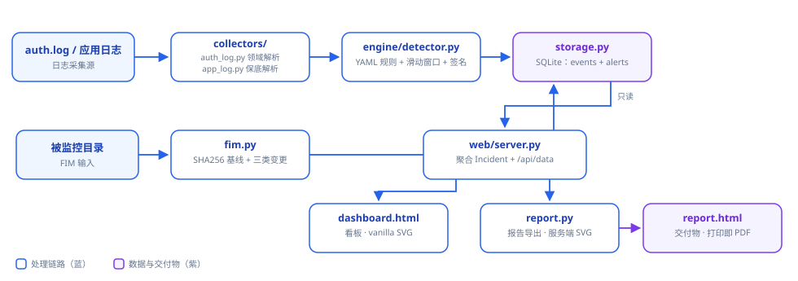
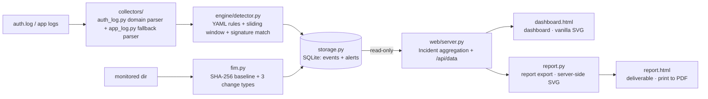

# SentinelWatch — Log & Traffic Intrusion Detection Platform

> A lightweight intrusion detection platform built on the **Python standard
> library only**, with **two data sources (logs + network traffic)**: SSH
> brute-force detection, file integrity monitoring (FIM), PCAP → HTTP
> reconstruction and HTTP-layer attack detection, alert
> aggregation/deduplication, and a visual dashboard.
>
> **This tool is for analyzing logs, traffic and hosts you are authorized to
> access. Deploying or monitoring hosts without authorization is illegal.**

## Core Capabilities

| Module | Capability | Design highlights (interview-ready) |
|---|---|---|
| Collection & parsing | auth.log domain parser + generic app-log fallback parser + **PCAP traffic reconstruction (v1.2)** | Two-layer design: the domain parser yields structured fields (user/ip/port); the fallback parser drops no lines — coverage first, the standard SIEM collector layering |
| Rule engine | YAML declarative rules + sliding windows + thresholds + **signature matching** | **New detection scenario = add one YAML file, no code change**; threshold detection catches behavior patterns (brute force), signature matching catches known attack fingerprints (Log4Shell payloads) — dual-mode, inspired by osquery/Wazuh + Suricata's division of labor |
| Traffic detection (v1.2) | Hand-written libpcap parser → TCP reassembly → HTTP reconstruction → normalization → reuse the rule engine | **Detection features decoupled from data sources**: all three collectors emit the same event model, so rules/storage/dashboard/report work unchanged. No scapy: 3 link types, both byte orders, ns precision, out-of-order reassembly |
| FIM | Directory SHA-256 baseline + added/modified/deleted detection | **Hashing instead of mtime** (`touch` can forge mtime, not SHA-256); the baseline must live outside the monitored tree (the CLI enforces this) |
| Alert aggregation | Group alerts into Incidents by (source IP, time window) | Alert-noise reduction + **no member is ever dropped** (explainability is the foundation of a blue-team tool's credibility) |
| Web dashboard | Alert timeline (line chart) + TOP source IPs (bar chart) + Incident view | **Zero third-party dependencies**: stdlib `http.server` + vanilla SVG; demoable on air-gapped networks |
| Report export | One-command standalone HTML security report (server-rendered SVG charts) | Dashboard = "live situational awareness", report = "after-the-fact deliverable" — two consumption forms of the same DB; `@media print` → save as PDF without pulling in reportlab |
| Storage | Single-file SQLite (events + alerts tables) | Events are traceable ("which raw events produced this alert"); composite `(ip, ts)` index backs window queries |

Built-in detection rules (in `rules/`, all declarative YAML):

| Rule | Criterion | Severity |
|---|---|---|
| SSH brute force | Threshold: ≥5 failures from one IP in 5 min | high |
| SSH username enumeration | Threshold: ≥5 Invalid user from one IP in 5 min | medium |
| Log4Shell JNDI payload | Signature: log contains `${jndi:` (CVE-2021-44228) | critical |
| Log4Shell obfuscated variant | Signature: `${lower:j` / `${::-j` nesting bypasses | high |
| Log4Shell JNDI reach | Signature: `com.sun.jndi.ldap.LdapCtx@` residue (JNDI lookup happened) | high |
| Log4Shell deserialization reach | Signature: `com.sun.rowset.JdbcRowSetImpl@` residue (serialized bytes were restored) | high |
| Fastjson autoType (traffic) | Signature: body contains `@type` + a known gadget class | critical |
| Log4Shell over HTTP (traffic) | Signature: normalized request contains `${jndi:` | critical |
| WebShell upload (traffic) | Signature: body contains `eval($_POST` / `Runtime.exec(` | critical |

## Quick Start

```bash
# No dependencies to install (Python 3.10+; PyYAML is the only import, for rule loading)
pip install pyyaml

# 1. Import logs → run rules → persist alerts
python cli.py import --log tests/sample_auth.log --db sentinelwatch.db --reset

# 1.5 Traffic detection (v1.2): PCAP goes into the same DB and the same rule engine
python cli.py traffic --pcap tests/fixtures/traffic_demo.pcap --db sentinelwatch.db
# → 8 packets → 5 HTTP requests → 3 CRITICAL (Log4Shell / Fastjson / WebShell)
#   the demo PCAP is synthesized by tools/pcapgen.py (valid checksums, opens in Wireshark)

# 2. File integrity monitoring: build a baseline first, rescan after changes
python cli.py fim --dir /path/to/watch --baseline /tmp/fim_baseline.json
#    (modify/add/delete files, then rerun the same command to produce FIM alerts)

# 3. Start the dashboard (binds 127.0.0.1 only by default)
python cli.py serve --db sentinelwatch.db --port 8080
#    then open http://127.0.0.1:8080

# 4. Export an HTML alert report (Ctrl+P in the browser → save as PDF)
python cli.py report --db sentinelwatch.db --out report.html
```

**Application-log detection example** (Log4Shell; the sample's attack lines are
real captures from the `cve-research/` reproduction lab):

```bash
python cli.py import --log tests/sample_app.log --format app --db log4shell.db --reset
# → 2 CRITICAL (${jndi: payload) + 2 HIGH (JNDI lookup / deserialization residues), benign lines stay silent
```

Bundled sample: `tests/sample_auth.log` (22 hand-crafted events: brute-force burst /
slow attempts / username enumeration / normal traffic / CRON noise). Importing it
produces exactly 2 alerts: **SSH brute force (HIGH, 203.0.113.9)** and
**SSH username enumeration (MEDIUM, 192.0.2.66)**, while the slow-attempt IP
(198.51.100.7, 3 attempts over 15 minutes) correctly stays silent.

A sample generated report is at [`reports/demo_report.html`](reports/demo_report.html).

## Architecture & Data Flow





**Why events and alerts are separate tables**: alerts must be explainable and
forensically sound — every alert traces back to the raw events that produced it.
That is a baseline requirement for any auditing system, and the dividing line
between a real tool and a toy.

**Why aggregation and suppression are separate stages**: in-engine `suppress`
handles "the same rule firing repeatedly"; `suppressor.py` handles "correlated
presentation across rules" (a single brute-force campaign that trips both the
brute-force rule and the enumeration rule should surface as one Incident, not two).

**Why two outputs (dashboard + report)**: the dashboard serves whoever is on
shift right now (live, interactive, newest-first); the report serves after-action
review and hand-off (static, printable, severity-ordered). Same DB, same
aggregation (`report.py` reuses `build_api_payload` from `web/server.py` —
a single source of truth, so the two paths can never drift apart).

## Tests

```bash
pytest tests/ -v     # 123 test cases
```

- `test_engine.py` (8): parsing / rule loading / threshold & window boundaries / storage round-trip
- `test_fim_suppressor.py` (9): FIM's three change types + exclusion rules + streaming
  hash correctness; incident aggregation by IP / window splitting / highest-severity
  selection / host-side grouping / ordering
- `test_report.py` (10): full report pipeline / XSS escaping (malicious alert fields
  must never escape) / server-rendered SVG charts / empty-DB degradation /
  zero external references / print styling / CLI subcommand
- `test_log4shell_rules.py` (11): generic log parser (timestamps / IPs / no dropped
  lines) / signature-match operators (AND/OR) / end-to-end Log4Shell rule detection /
  suppression & IP attribution / CLI
- `test_fastjson_rules.py` (12): six Fastjson rules end-to-end / three bypass
  techniques asserted line by line / suppression semantics (zero alerts on benign
  business lines) / IP attribution / CLI
- `test_ioc.py` (13): five IOC types / domain-suffix boundaries / aggregation with hit
  counts / true negatives (timestamps must not be read as IPv6)
- `test_pcap.py` (21): PCAP parsing (endianness / nanosecond timestamps / three link
  types / truncation) / out-of-order TCP reassembly / HTTP keep-alive with multiple
  requests / server responses and UDP produce no events / URL-encoded and case-shifted
  payloads still detected / zero false positives on benign traffic / **streaming
  parser** (same event set as the full-load path, no keep-alive requests dropped,
  idle flows released, corrupt frame lengths rejected)
- `test_sigma_export.py` (31): all 15 rules carry tags with valid format / threshold
  rules must be rejected / AND-OR mapped to `all of` and `1 of` / **judgement
  equivalence sample by sample before and after conversion** (including negative
  samples that guard "missing one AND literal must not match") / deterministic UUIDs /
  committed `sigma/` stays in sync with `rules/` / ATT&CK numbers must come from tags /
  official pySigma parses the output (runs only when installed)

**Signature matching (v1.0) semantics**: every substring in `raw_contains` must be
present (AND, narrows the match); any substring in `raw_contains_any` suffices
(OR, variant families). The two operators are explicit — a security rule's matching
condition must be predictable, never convention-based.

## Public-Dataset Benchmark (`bench/`)

A hand-made 8-packet sample proves the code runs; it says nothing about whether the
detector is any good — **setting your own exam means you always score 100%**. So
there is `bench/`:

```bash
python bench/run_benchmark.py --self-test     # verify the harness (no dataset needed)
python bench/run_benchmark.py --pcap data/x.pcap \
    --labels bench/labels/cic_ids2017_thursday_web.json --out out/
```

Three numbers: **recall / false-positive rate / throughput**, each reproducible by a
command. The labelling rule is declared explicitly — the dataset labels flows while
this tool emits per-request events, so instead of using the shipped labels we use
「attack time window + attacker source IP」 and print that rule verbatim in the report
so anyone can re-check it.

**Status: methodology and harness are ready; real-dataset numbers are pending.**
CIC-IDS2017's direct links now 302 back to a form page, so the 7.7 GB file needs a
manual request. No numbers are written until the data lands — a fabricated figure is
worse than a blank. See [`bench/BENCHMARK.md`](bench/BENCHMARK.md) and
[`bench/DATASETS.md`](bench/DATASETS.md).

**The work already paid for itself**: it immediately exposed a bug no synthetic sample
could ever catch — the parser used `read_bytes()` to load the whole file into memory,
so a 7.7 GB capture kills the process in the first second. It is now a streaming
parser (`iter_events()`, memory bounded by the number of active flows rather than file
size). **Changing the ruler is how you find out how long your sword actually is** —
independent of whatever the recall number turns out to be.

## ATT&CK Coverage & Sigma Export (v1.3)

### Coverage: the denominator is the declared scope

Claiming "I cover ATT&CK" carries no information — the enterprise matrix has 200+
techniques, so any single-purpose detection project lands under 1%, a number that is
neither honest nor actionable. The denominator here is the **declared detection
scope**: techniques the three data sources (auth logs / app logs / HTTP traffic) plus
FIM can see in principle — 15 of them.

| Granularity | Covered | Total | Rate | What it measures |
|---|---|---|---|---|
| Sub-technique | 6 | 15 | **40.0%** | how fine-grained the judgement is |
| Parent technique | 5 | 10 | **50.0%** | how complete the scenarios are |

Covered: T1110 / T1110.001 (brute force), T1087 (account discovery), T1190 (exploit
public-facing app, 12 rules), T1059 (command execution), T1505.003 (web shell).

The 9 uncovered ones are not oversights — each carries a note on exactly what is
missing (see the backlog table in [reports/attack_coverage.md](reports/attack_coverage.md)).
**T1087.001 is merely a tagging gap** (the capability exists, the rule lacks the
sub-technique tag); **T1046 / T1041 / T1071.001 need entirely new judgement types** —
half-open connection counting, egress byte aggregation, beacon interval variance.
Conflating those two kinds of gaps is how a "coverage report" turns into
self-congratulation.

```bash
python tools/attack_coverage.py                        # console table
python tools/attack_coverage.py --md reports/attack_coverage.md
python tools/attack_coverage.py --json                 # machine-readable
```

Coverage is **derived dynamically from the `attack.*` tags** in the rule files, not a
hand-copied number: drop a tag and the figure falls immediately. That is what makes
the report live — and safe to wire into CI.

### Sigma export: making the judgements consumable elsewhere

Sigma is the lingua franca of detection rules (what YARA is to files, Snort to
traffic). A rule that converts to Sigma can be consumed by Splunk / Elastic / Sentinel
/ QRadar directly — the lowest bar for "this logic can circulate in the community".

```bash
python tools/to_sigma.py                    # → sigma/ (13 rules)
python tools/to_sigma.py --cased            # strictly case-equivalent variant
sigma check sigma/                          # official validator (pip install sigma-cli)
```

**Result: 13 converted, 2 explicitly refused, official validation reports 0 errors,
0 condition errors, 0 issues.**

Conversion is semantic alignment, not format translation. Three places where cutting
corners would be fatal:

1. **Threshold rules cannot be expressed.** Sigma has no native "N times within a
   window" syntax (that belongs to SIEM-side correlation). So `ssh-brute-force` and
   `ssh-user-enumeration` raise `NotConvertible` with a reason instead of quietly
   emitting a `threshold=1` rule — such a rule would flood the queue in production,
   which is worse than having no rule. **Better not to convert than to convert wrong.**
2. **AND must be split across selections.** In Sigma a list under one key means OR,
   so `raw_contains` (AND) becomes `selection_all_1/2/...` + `all of selection_all_*`,
   while `raw_contains_any` (OR) becomes `1 of selection_any_*`. This is the easiest
   place to turn AND into OR, and `test_sigma_export.py` guards it with a case where
   **dropping one AND literal must not match**.
3. **Case semantics differ.** The engine's `raw_contains` is case-**sensitive**; Sigma's
   `|contains` is not by default. The default export is therefore looser than the
   source rule, and `--cased` emits `|contains|cased` for strict equivalence. Tests
   assert "engine hit ⇒ Sigma hit" (looser is acceptable, a miss is not) rather than
   bidirectional equality — that is the line drawn between the two.

**Two real spec details fixed along the way** (both caught by the official validator,
not by reading docs):

- `cve.2021.44228` ❌ → `cve.2021-44228` ✅: pySigma's CVETagValidator uses
  `^\d+-\d+$`, so **CVE tags take a hyphen**. The initial version failed all 11 rules
  with `InvalidPatternTagIssue`.
- `sigma check` fetches MITRE ATT&CK data over the network to validate tags. Offline,
  add `-x attacktag` to skip that one check; syntax, condition references and field
  modifiers are still validated.

## Relationship to Wazuh / osquery (Homage & Differences)

| | SentinelWatch | Wazuh |
|---|---|---|
| Deployment | Single file + SQLite, copy-and-run | Agent + Manager + Elastic stack |
| Rules | YAML declarative, single directory load | XML rules + decoder system |
| Realtime | File import (live agent planned for v1.5) | Live collection |
| Positioning | Learning / demos / small-scale host self-audit | Production enterprise deployment |

The design ideas (baseline + declarative rules + sliding windows + alert
aggregation) pay homage to osquery and Wazuh, while the engineering scale stays
deliberately lightweight — **the goal of this project is to explain the core SIEM
pipeline end-to-end, not to rebuild Wazuh**.

## Disclaimer

For educational use and authorized security analysis only. Collecting logs or
monitoring files on hosts without authorization is illegal; you bear full legal
responsibility for your usage.
