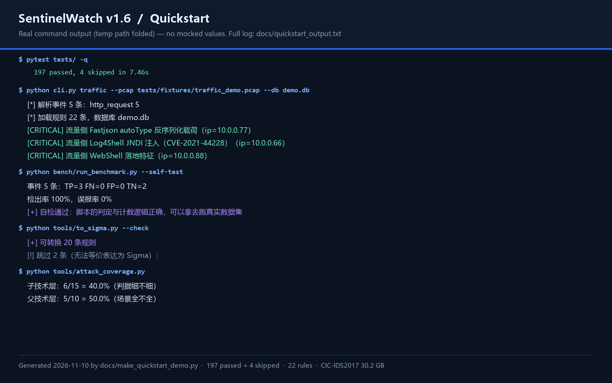
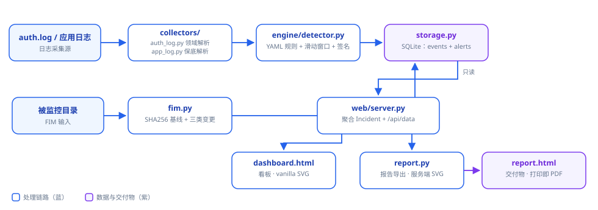
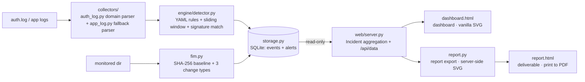

# SentinelWatch — Log & Traffic Intrusion Detection Platform

[](https://github.com/yliucherish/sentinelwatch/actions/workflows/ci.yml)

> A lightweight intrusion detection platform built on the **Python standard
> library only**, with **two data sources (logs + network traffic)**: SSH
> brute-force detection, file integrity monitoring (FIM), PCAP → HTTP
> reconstruction and HTTP-layer attack detection, alert
> aggregation/deduplication, and a visual dashboard.
>
> **v2.4 (2026-11-15)**: v2.3's claim — "CRS flags dangerous words, we flag
> injection syntax" — was still just an assertion. This round turned it into a
> **cost curve**: four candidate criteria for the same shape (a bare command word
> inside a parameter), same corpora, same denominator:
>
> | Criterion form | CRS detections | Gain | Real-traffic FPs |
> |---|---:|---:|---:|
> | Word list (full command names) | 356 | +43 | **80** |
> | Word list (rare names only) | 331 | +18 | **33** |
> | **Syntax (command name + option/path)** | **335** | **+22** | **0** |
>
> The word-list versions did not fail because of word choice: their boundary
> condition does not hold. The pattern meant "the command name is followed by
> whitespace or end-of-string", but **every request line already ends with
> ` URI HTTP/1.1`**, and a `+` decoded from `%2b` impersonates "end of name" too —
> so the condition is nearly always true in HTTP. Requiring the name to be
> followed by an option or a path fixed both axes at once. One rule shipped
> (30 → 31 rules, 27 → 28 Sigma), CRS full set **313 → 335 (16.1% → 17.3%)**,
> **main matrix untouched**: real false positives remain **4/150,262** and the
> new rule adds **0** detections on real attack traffic.
> See [`BENCHMARK.md`](bench/BENCHMARK.md) §2.14 and
> [`results/cmd_syntax_curve.md`](bench/results/cmd_syntax_curve.md).
>
> **v2.3 (2026-11-14)**: grew the only third-party evidence from **59 cases to
> 2,503** — no longer a hand-transcribed subset of four CRS libinjection test
> files, but the **entire OWASP CRS regression suite** for the four categories
> this project claims (148 rule files).
>
> Result: **313/1,940 = 16.1%**, far worse looking than the 54.2% on 59 cases —
> **and worse-looking is the correct outcome**, because those 59 were picked
> precisely for having regex-friendly shapes. Scaling up settled three things:
> (1) excluding CRS's character-frequency scoring rules leaves the number at
> **16.1%** again, so the gap is *not* "we skip scored models";
> (2) **41% of the misses sit in three rule families** and reduce to one
> sentence — CRS flags *"a dangerous word appeared"*, this project flags
> *"injection syntax appeared"*; that is the bill for v2.1 tightening the
> criteria to get false positives down;
> (3) those 563 `no_expect_ids` cases are **not benign labels** — they include
> real injections such as `pg_sleep(15)`. The first pass treated them as benign
> and reported a "4.44% false-positive rate", a metric pointing the wrong way.
> See [`BENCHMARK.md`](bench/BENCHMARK.md) §2.13 and
> [`results/crs_regression.md`](bench/results/crs_regression.md).
>
> **v2.2 (2026-11-14)**: changed the *dimension* of scanner detection — from
> "who is scanning" (User-Agent, a self-declared identity, trivially forged) to
> "what is being scanned" (the path in `uri`, which is what the client actually
> did). Same goal, same corpus: the UA criterion produced **80 false positives**,
> the path criterion **0**, with 8 hits that are all genuine probes
> (`/.git/HEAD` ×4, `/HNAP1` ×4, one internal host).
> **It is not shipped.** Those 8 are labelled benign (the dataset only labels
> the known attack windows of attack days); shipping it would take Thursday FP
> from 42 to 50 and the headline "4 real false positives / 150,262" to 12 — and
> the *only* way to keep the number clean is to relabel those 8 as attacks,
> which would be fitting the ruler to the rule, since the rule was written by
> looking at those very paths. So the criterion and its measurements live in
> `bench/proposed/`; `rules/` stays at 30, and tests guard both "not shipped"
> and "not rotted". See [`BENCHMARK.md`](bench/BENCHMARK.md) §2.12.
>
> **v2.1 (2026-11-14)**: added criteria for RCE and SSRF, 28 → **30 rules**
> (27 exportable to Sigma). Command injection is judged by **four syntactic
> positions** (command substitution `$( )`, backticks, separators `; && ||`,
> pipes `|`), each followed by a command name *and* command context — not by
> "the string `;id` appeared". SSRF is judged by the **"scheme + host" pair**:
> `127.0.0.1` alone is just text (logs, docs, samples); it needs `http://` in
> front of it to mean "make the server fetch this".
> **The cross-project denominator grew from 117 to 184**, so the headline
> 91.5% → **81.5%** is *not* a regression and not directly comparable — the
> 67 newly-counted cases (rce 49 / ssrf 18) are simply harder. What *is*
> comparable are the four columns whose denominator never moved: SQLi 47/50,
> XSS 26/32, path traversal 20/20, deserialization 14/15 — **unchanged**, i.e.
> the new criteria did not crowd out the old ones. `rce` **26/49**, `ssrf`
> **17/18**.
> **Cost measured before the rules were written**: both rules show **0 real
> false positives** across 150,262 benign-labelled requests, and because they
> never fire on any of the 159,187 requests (attack windows included), the
> per-request matrix in §2.3 is numerically unchanged.
> The scanner user-agent family was **written, measured, and deliberately not
> shipped**: 8/8 on the bypasslab corpus versus 80 false positives on the full
> benign traffic (all one internal host running Nmap NSE) — a rule with 0/80
> precision should not be on by default. See
> [`BENCHMARK.md`](bench/BENCHMARK.md) §2.11.
>
> **v2.0 (2026-11-14)**: criteria moved from *enumerating spellings* to
> *describing shapes*. `http-sqli-union-select` used to list four substrings
> (`union select`, `union/**/select`, …) — i.e. "the four samples I happened to
> see". It is now one regex, `un\s*ion\s*(?:all\s+|distinct\s+)?\(?\s*se\s*lect`,
> which encodes the **SQL grammar constraint**: arbitrary whitespace/comments may
> separate `union` from `select`. The same shift covers SQLi boolean / error-based
> / stacked, XSS event handlers, path traversal, JNDI, fastjson and Java
> serialization: 23 → **28 rules** (25 exportable to Sigma).
> **Cross-project recall 55.6% → 91.5%** (OWASP CRS subset 12/59 → **27/59**; the
> frozen holdout set, never used for tuning, 7/19 → **11/19**).
> **Measure the false-positive cost before writing the rule**: new
> `bench/run_rule_cost.py` counts hits per rule over 150,262 benign requests from
> all three captures. The result is not "zero false positives" but the claim worth
> testing — **the 4 known ones (rich-text `ar.logger.php`) did not grow by a single
> case**, and the 6 new rules plus 11 reshaped criteria added **0** new false
> positives. It caught a real mistake on the spot: `http-java-serialized` fired 8
> times on an ad-network cookie where `ro0ab` was merely a fragment inside a base64
> string. It also caught a mistake of its own: the first version truncated bodies at
> 1,000 characters and therefore missed Monday's three `content-length: 18,856`
> requests, reporting "0 real false positives" — **a wrong answer in the reassuring
> direction**.
> All three captures re-run: **TP 855 → 857**, FP 42 / TN 47,143 / 4 real false
> positives **all unchanged**. See [`BENCHMARK.md`](bench/BENCHMARK.md) §2.10.
>
> **v1.9 (2026-11-14)**: fixed the normalisation gap v1.8 found — in form encoding
> `+` means a space, and `normalize()` never decoded it, so an entire payload class
> (`id=1+UNION+SELECT+...`) walked straight past the rules. The fix rewrites `+`
> only in the query string and in `x-www-form-urlencoded` bodies, and **before**
> `unquote()` (otherwise a literal `%2B` gets mangled); `raw` is untouched.
> **All three captures re-run**: Thursday TP **853 → 855**, FP stays 42, Monday and
> Tuesday false positives unchanged, overall recall 9.56% → **9.58%**, payload
> recall **853/863 → 855/863 = 99.07%**; alert-level results are byte-for-byte
> identical (8 alerts, 8 TP / 0 FP); cross-project recall **49.6% → 55.6%**.
> See [`BENCHMARK.md`](bench/BENCHMARK.md) §2.9.
>
> **v1.8 (2026-11-14)**: added a **cross-project benchmark** — the rules are
> replayed against [bypasslab](../bypasslab/)'s evasion corpus (228 cases, incl.
> 59 OWASP CRS third-party cases). The first run measured **58/117 = 49.6%**, and it
> pinpointed a normalisation gap: `+` is never decoded as a space. Decoding it
> alone lifts recall to 55.6% (SQLi 32.0% → 46.0%) — fixed in v1.9, and the
> criterion reshaping in v2.0 brings it to **91.5%**. **No rule changed** in v1.8
> — only a new bench script and invariant tests;
> see [`BENCHMARK.md`](bench/BENCHMARK.md) §2.8.
>
> **v1.7 (2026-11-10)**: closed the "7,181 brute-force requests, 0 hits" gap with a
> **window-frequency rule** for HTTP login endpoints. The threshold is calibrated on
> two all-benign working days first, then validated on the attack day; window alerts
> are evaluated **at alert level**, never merged into the per-request matrix.
> At that point **30 rules / 27 exportable to Sigma** (3 threshold rules explicitly refused; one more sits in `bench/proposed/`, measured but not shipped — see §2.12),
> **207 passed + 8 skipped** at the time. See [`bench/run_frequency.py`](bench/run_frequency.py)
> and `bench/BENCHMARK.md` §2.6.
>
> **v1.6 (2026-11-09, benchmark baseline)**: three full-day CIC-IDS2017 captures
> (30.2 GB, 159,187 HTTP requests) — **4 real false positives out of 150,262**,
> **853/863 = 98.84%** of payload-bearing attacks hit, overall recall 9.56%,
> precision 95.31%. That matrix was unchanged in v1.7; **v1.9 and v2.0 re-ran it
> after the normalisation and criterion changes and it is now TP 857 / FN 8,068
> with false positives unchanged** (§2.9, §2.10). Numbers and
> reproduction commands: [`bench/BENCHMARK.md`](bench/BENCHMARK.md); raw reports:
> [`bench/results/`](bench/results/).
>
> **This tool is for analyzing logs, traffic and hosts you are authorized to
> access. Deploying or monitoring hosts without authorization is illegal.**

## Core Capabilities

| Module | Capability | Design highlights (interview-ready) |
|---|---|---|
| Collection & parsing | auth.log domain parser + generic app-log fallback parser + **PCAP traffic reconstruction (v1.2)** | Two-layer design: the domain parser yields structured fields (user/ip/port); the fallback parser drops no lines — coverage first, the standard SIEM collector layering |
| Rule engine | YAML declarative rules + sliding windows + thresholds + **signature matching** | **New detection scenario = add one YAML file, no code change**; threshold detection catches behavior patterns (brute force), signature matching catches known attack fingerprints (Log4Shell payloads) — dual-mode, inspired by osquery/Wazuh + Suricata's division of labor |
| Traffic detection (v1.2) | Hand-written libpcap parser → TCP reassembly → HTTP reconstruction → normalization → reuse the rule engine | **Detection features decoupled from data sources**: all three collectors emit the same event model, so rules/storage/dashboard/report work unchanged. No scapy: 3 link types, both byte orders, ns precision, out-of-order reassembly |
| Web attack detection (v1.5 → v2.0) | SQLi (UNION / boolean / time-based / metadata / error-based / stacked), XSS, path traversal, Java serialization, overlong UTF-8 | **Criteria describe the *shape*, not a *spelling***. A substring can only enumerate samples you have seen; a regex can encode "what this attack class must satisfy grammatically" — so `un/**/ion se/**/lect`, never seen before, still hits. Cross-project recall thus went 49.6% → **91.5%**. Criteria still demand explicit injection syntax (`onerror=alert`, not a bare `onerror`) — **better to under-report than to be switched off in week one** |
| Rule standardisation (v1.3 → v2.0) | ATT&CK tags on all **30** rules + **Sigma export (27/30)** | **Judgements can be consumed elsewhere**: Sigma is the common tongue of detection rules. The 3 window-threshold rules are **explicitly refused** rather than silently downgraded to `threshold=1` (better not to convert than to convert wrongly); regex criteria map to `\|re` and must land in the **same OR group** as substrings (splitting them into two groups re-creates a silent never-match bug); the coverage denominator is the declared scope, not the whole matrix |
| Behavioural criterion (v1.7) | HTTP login-endpoint frequency threshold over a 60s sliding window | **Signatures ask "what is in this request"; thresholds ask "how many times did this IP do it"**: CIC Thursday's 7,181 brute-force requests carry no injection payload, so a signature rule cannot hit them — that is a missing *criterion type*, not a shortage of regexes. Threshold calibrated on all-benign captures; alert-level evaluation kept separate (§2.6) |
| Public-dataset benchmark (v1.6) | `bench/`: PCAP + labels → per-request confusion matrix + report | **Measure yourself with somebody else's ruler**: three full CIC-IDS2017 captures, recall / false-positive rate / throughput, plus denominator breakdown and FP attribution. Label windows are UTC while event timestamps are local wall-clock — **compare on epoch only**, guarded by four-timezone subprocess tests |
| FIM | Directory SHA-256 baseline + added/modified/deleted detection | **Hashing instead of mtime** (`touch` can forge mtime, not SHA-256); the baseline must live outside the monitored tree (the CLI enforces this) |
| Alert aggregation | Group alerts into Incidents by (source IP, time window) | Alert-noise reduction + **no member is ever dropped** (explainability is the foundation of a blue-team tool's credibility) |
| Web dashboard | Alert timeline (line chart) + TOP source IPs (bar chart) + Incident view | **Zero third-party dependencies**: stdlib `http.server` + vanilla SVG; demoable on air-gapped networks |
| Report export | One-command standalone HTML security report (server-rendered SVG charts) | Dashboard = "live situational awareness", report = "after-the-fact deliverable" — two consumption forms of the same DB; `@media print` → save as PDF without pulling in reportlab |
| Storage | Single-file SQLite (events + alerts tables) | Events are traceable ("which raw events produced this alert"); composite `(ip, ts)` index backs window queries |

Built-in detection rules (in `rules/`, all declarative YAML):

| Rule | Criterion | Severity |
|---|---|---|
| SSH brute force | Threshold: ≥5 failures from one IP in 5 min | high |
| SSH username enumeration | Threshold: ≥5 Invalid user from one IP in 5 min | medium |
| Log4Shell JNDI payload | Signature: log contains `${jndi:` (CVE-2021-44228) | critical |
| Log4Shell obfuscated variant | Signature: `${lower:j` / `${::-j` nesting bypasses | high |
| Log4Shell JNDI reach | Signature: `com.sun.jndi.ldap.LdapCtx@` residue (JNDI lookup happened) | high |
| Log4Shell deserialization reach | Signature: `com.sun.rowset.JdbcRowSetImpl@` residue (serialized bytes were restored) | high |
| Fastjson autoType (traffic, reshaped in v2.0) | Regex: `@type` points at a **fully-qualified class-name shape** (≥3 dot-separated segments), no longer a blacklist of gadget names | critical |
| Log4Shell over HTTP (traffic, reshaped in v2.0) | Regex: `ndi:` + short padding + `://`. In `${jndi:${lower:l}dap://}` the `l` is lookup-expanded, so the literal `${jndi:` never exists | critical |
| WebShell upload (traffic) | Signature: body contains `eval($_POST` / `Runtime.exec(` | critical |
| SQLi · UNION select (traffic) | Regex `un\s*ion\s*(?:all\s+\|distinct\s+)?\(?\s*se\s*lect` over `sql_view` (comments normalised to whitespace) | critical |
| SQLi · boolean true/false (traffic) | Regex: and/or + comparison **grammar**, one side must be a number or a quoted string (otherwise `?q=red and size=xl` false-positives) | high |
| SQLi · time based (traffic) | Signature: `sleep(` / `benchmark(` / `waitfor delay` | high |
| SQLi · metadata probe (traffic) | Signature: `information_schema` / `load_file(` / `into outfile` | high |
| SQLi · error based (traffic, v2.0) | Signature: `extractvalue(` / `updatexml(` / `procedure analyse` / `concat(0x` | high |
| SQLi · stacked queries (traffic, v2.0) | Regex: `;\s*(?:drop\|truncate\|alter\|…)` | critical |
| XSS · script tag (traffic) | Signature: `<script` / `<svg onload` / `javascript:alert(` plus **any namespace prefix** (`<x:script>`) | high |
| XSS · event handler (traffic) | Regex: tag + event attribute + **executable function**. `onerror=alert(1)` on its own is not XSS — it only executes inside an HTML tag context | medium |
| Path traversal (traffic) | Signature: `../../` / `/etc/passwd` / `..\..\` | high |
| Path traversal · obfuscated (traffic, v2.0) | Regex: `.../` (three dots), `0x2e…0x2f` (hex dot/slash) and a third encoding variant | high |
| Java serialization stream (traffic, v2.0) | Regex: base64 magic `ro0ab` / hex `aced0005`, **with a base64 boundary** (an unbounded substring match fired 8 times on an ad-network cookie) | critical |
| Overlong UTF-8 encoding (traffic, v2.0) | Regex: `%c0%af` / `%e0%80%xx` / `%f0%80%80%xx`. RFC 3629 forbids these; **no legitimate browser emits them**. Matched on `raw`, because `unquote()` turns `%c0%af` into U+FFFD and the trait vanishes from `normalized` | high |
| Command injection (traffic, v2.1) | Regex: **four syntactic positions** — `$(cmd)` must close, backticks need a leading boundary, `;`/`&&`/`\|\|` must be followed by a command name *and* command context, a single pipe by arguments or end-of-line. The command-name list is 30 entries (`id`/`whoami`/`cat`/`curl`/`nc`/`bash`…); **`${cmd}` is deliberately not accepted** (it is indistinguishable from an ad-network tracking macro — 13 false positives on the Monday capture) | critical |
| SSRF (traffic, v2.1) | Regex: **scheme + host** — cloud metadata (`169.254.169.254`/`100.100.100.200`/`metadata.google.internal`), loopback (`127.x`, shorthand `127.1`, `localhost`, `0.0.0.0`, `[::1]`, `[::ffff:127.0.0.1]`), RFC 1918, radix variants (`2130706433`/`0x7f000001`/`017700000001`), `file:///`, `gopher://` | high |

> The v1.5 group exists because **measuring against a public dataset made the gap
> obvious**: CIC-IDS2017's web attacks are SQLi / XSS / form brute force, while the
> then-13 rules were all Log4Shell(2021) / Fastjson / WebShell — not one of them could
> fire. The lesson: **organise criteria by attack technique, not only by CVE number.**
> See [`bench/DATASETS.md`](bench/DATASETS.md).

## Quick Start

```bash
# No dependencies to install (Python 3.10+; PyYAML is the only import, for rule loading)
pip install pyyaml

# 1. Import logs → run rules → persist alerts
python cli.py import --log tests/sample_auth.log --db sentinelwatch.db --reset

# 1.5 Traffic detection (v1.2): PCAP goes into the same DB and the same rule engine
python cli.py traffic --pcap tests/fixtures/traffic_demo.pcap --db sentinelwatch.db
# → 8 packets → 5 HTTP requests → 3 CRITICAL (Log4Shell / Fastjson / WebShell)
#   the demo PCAP is synthesized by tools/pcapgen.py (valid checksums, opens in Wireshark)

# 2. File integrity monitoring: build a baseline first, rescan after changes
python cli.py fim --dir /path/to/watch --baseline /tmp/fim_baseline.json
#    (modify/add/delete files, then rerun the same command to produce FIM alerts)

# 3. Start the dashboard (binds 127.0.0.1 only by default)
python cli.py serve --db sentinelwatch.db --port 8080
#    then open http://127.0.0.1:8080

# 4. Export an HTML alert report (Ctrl+P in the browser → save as PDF)
python cli.py report --db sentinelwatch.db --out report.html
```

**30-second demo**: every line below was captured from five commands that
[`docs/make_quickstart_demo.py`](docs/make_quickstart_demo.py) actually runs — no
hand-written or mocked values. The unabridged output is kept in
[`docs/quickstart_output.txt`](docs/quickstart_output.txt) for line-by-line
verification (only the random temp path is folded to `demo.db` in the image).



**Application-log detection example** (Log4Shell; the sample's attack lines are
real captures from the `cve-research/` reproduction lab):

```bash
python cli.py import --log tests/sample_app.log --format app --db log4shell.db --reset
# → 2 CRITICAL (${jndi: payload) + 2 HIGH (JNDI lookup / deserialization residues), benign lines stay silent
```

Bundled sample: `tests/sample_auth.log` (22 hand-crafted events: brute-force burst /
slow attempts / username enumeration / normal traffic / CRON noise). Importing it
produces exactly 2 alerts: **SSH brute force (HIGH, 203.0.113.9)** and
**SSH username enumeration (MEDIUM, 192.0.2.66)**, while the slow-attempt IP
(198.51.100.7, 3 attempts over 15 minutes) correctly stays silent.

A sample generated report is at [`reports/demo_report.html`](reports/demo_report.html).

## Architecture & Data Flow





**Why events and alerts are separate tables**: alerts must be explainable and
forensically sound — every alert traces back to the raw events that produced it.
That is a baseline requirement for any auditing system, and the dividing line
between a real tool and a toy.

**Why aggregation and suppression are separate stages**: in-engine `suppress`
handles "the same rule firing repeatedly"; `suppressor.py` handles "correlated
presentation across rules" (a single brute-force campaign that trips both the
brute-force rule and the enumeration rule should surface as one Incident, not two).

**Why two outputs (dashboard + report)**: the dashboard serves whoever is on
shift right now (live, interactive, newest-first); the report serves after-action
review and hand-off (static, printable, severity-ordered). Same DB, same
aggregation (`report.py` reuses `build_api_payload` from `web/server.py` —
a single source of truth, so the two paths can never drift apart).

## Tests

```bash
pytest tests/ -q
# 435 passed, 8 skipped (443 collected; wall time varies by machine)
# Windows figures: 7 of the 8 skips are TZ-subprocess cases that Windows ignores;
# on Linux / CI they run and count as passed. The 8th needs optional `sigma`.
```

| Test file | Cases | What it guards |
|---|---:|---|
| `test_engine.py` | 9 | Rule loading / threshold & window boundaries / storage round-trip |
| `test_fim_suppressor.py` | 8 | FIM's three change types + exclusions + streaming hash / incident aggregation |
| `test_report.py` | 9 | Full report pipeline / XSS escaping / server-rendered SVG / print styling |
| `test_log4shell_rules.py` | 12 | Generic log parser / AND-OR operators / four rules end-to-end / IP attribution |
| `test_fastjson_rules.py` | 12 | Six Fastjson rules / three bypasses line by line / suppression semantics |
| `test_ioc.py` | 21 | Five IOC types / domain-suffix boundaries / hit counts / true negatives |
| `test_pcap.py` | 37 | Endianness / ns precision / three link types / **native pcapng + `if_tsresol`** / out-of-order TCP reassembly / keep-alive / corrupt frames rejected / **v1.9 form `+` decoding (three constraints)** / **v2.0 `%uXXXX` and numeric-entity decoding, incl. a negative assertion that named entities stay undecoded** / **`sql_view` normalises the criterion, never the evidence** |
| `test_match_operators.py` | 8 | **Engine semantics** (not any single rule): regex and substrings share one OR group / `raw_contains` is the AND group / the two groups combine / `field` really selects a view / invalid regex, unknown field, unknown operator, operator-less `match` all fail **at load time** |
| `test_sigma_export.py` | 43 | Tags on all **28** rules / threshold rules must be refused / AND-OR mapped to `all of` and `1 of` / regex mapped to `\|re` in the same group as substrings / **engine verdict == Sigma verdict on 9 samples** / deterministic UUIDs / official pySigma parses the output |
| `test_web_attack_rules.py` | 84 | Six SQLi families / two XSS / two traversal variants / encoding bypasses / JNDI obfuscation / deserialization — each with **same-family variant** parametrisation (6 separators, 6 tautologies, 5 namespace tags…) plus near-miss true negatives / end-to-end PCAP / **a documented false positive is a positive assertion, not a deleted test** |
| `test_bench_selftest.py` | 7 | Four-timezone subprocess regression (UTC / Shanghai / New York / Berlin) |
| `test_bench_labels.py` | 18 | "Config" values that are actually measured conclusions: ADT offset 3, NAT'd attacker IP, epoch comparison, window + IP conjunction, `by_shape` breakdown, recall upper bound |
| `test_frequency.py` | 13 | Frequency-rule selection / closed sliding-window boundary / alert-level TP-FP / alerts on all-benign data must count as FP / no alert above threshold / **four-timezone window overlap** |
| `test_crosscheck.py` | 9 | Cross-project benchmark invariants: out-of-scope categories never enter the denominator / scanner cases are attacks, not benign / UA-carried payloads must reach `raw` / **form `+` must be decoded** / **a literal `%2B` must survive** / holdout details stay private / no absolute paths in the report |
| `test_rule_cost.py` | 6 | **The cost tool's own accounting**: the cache must keep the **whole** body (v2.0 once truncated at 1,000 chars, so payloads deep in long bodies were never counted and the tool reported "0 real false positives") / a rebuilt event must still be hit by the production criterion / UA-carried payloads must reach the judged view / all raw-material fields present |
| `test_rce_ssrf_rules.py` | 64 | Four syntactic positions for command injection (URL-encoded and POST-form variants) + benign controls (ad macro `${id}`, `sort=name|id`, `;jsessionid=`, unclosed `$(id`, paired backticks inside compressed bid-stream bytes) / five SSRF host classes (incl. `127.1`, `[::ffff:127.0.0.1]`, radix variants) + benign controls (host without scheme, `172.32` outside RFC 1918) / **mixed-radix `0x7f.1` is a recorded gap, guarded by an assertion** / **the scanner UA rule must not ship, and `COVERAGE["scanner"]` must carry the 0/80 figure** |
| `test_proposed_rules.py` | 31 | **Decision guard for `bench/proposed/`**: a rule that is not loaded must really stay out of `rules/` (guards against a casual `git mv`) / 16 probe paths must still match and 10 benign paths must not (guards against rot in code nobody runs) / `(?i)` case-insensitivity (`uri` is not lower-cased) / **the criterion reads `uri` only** — a blog post mentioning `/.git/HEAD` is not a probe |

**Timezone regression must include a non-UTC zone**: label windows are UTC while
event timestamps are naive wall-clock rendered by the collector's local
`datetime.fromtimestamp()`. Both sides are compared on epoch. This bug bit twice
(TP=0 on CI, and `TP 0 FN 0 FP 895` on the first real-dataset run) and passes by
coincidence on a UTC machine — hence four subprocesses, not one.

**Signature matching semantics** (v1.0, extended to three operators in v2.0): every
substring in `raw_contains` must be present (**the AND group**, narrows the match);
`raw_contains_any` and `raw_regex` together form **one OR group** — any of them
suffices (variant families). The operators are explicit — a security rule's matching
condition must be predictable, never convention-based.

> **That OR-group rule cost us a real bug, worth spelling out.** v2.0 first
> implemented `raw_regex` as its own AND group. After adding a "namespaced tag"
> regex to the XSS rule, the rule demanded **both `<script` and `<x:script>`** — it
> almost never fired. And in the benchmark it showed up as **false positives
> dropping from 1 to 0**, which looks like good news. The most dangerous failure mode
> of a security rule is not an error — it is "looks like it works, no longer matches".
> Errors get fixed; a silent failure just makes everyone believe the rule is precise
> because it never false-positives. Two guards now exist: the engine test
> `test_regex_and_substring_share_one_or_group`, and the exporter's "regex must join
> the substring OR group" rule.

Which view a criterion is matched against is chosen by `match.field`: `raw` (the
evidence), `normalized` (URL-decoded to a fixed point, lowercased), `sql_view`
(comments and whitespace noise additionally removed), `uri` / `body` / `method` /
`host`. **A misspelled field name fails at load time** rather than silently degrading
into "never matches".

## Public-Dataset Benchmark (`bench/`)

A hand-made 8-packet sample proves the code runs; it says nothing about whether the
detector is any good — **setting your own exam means you always score 100%**. So
there is `bench/`:

```bash
python bench/run_benchmark.py --self-test     # verify the harness (no dataset needed)
python bench/run_benchmark.py --pcap data/x.pcap \
    --labels bench/labels/cic_ids2017_thursday_web.json --out out/
```

Three numbers: **recall / false-positive rate / throughput**, each reproducible by a
command. The labelling rule is declared explicitly — the dataset labels flows while
this tool emits per-request events, so instead of using the shipped labels we use
「attack time window + attacker source IP」 and print that rule verbatim in the report
so anyone can re-check it.

**Status: done.** Three full-day CIC-IDS2017 captures (Monday / Tuesday / Thursday,
30.2 GB, **159,187 HTTP requests**) have been measured end to end. Per-request
details live in `out/bench_*.csv`; all numbers and reproduction commands are in
[`bench/BENCHMARK.md`](bench/BENCHMARK.md).

| Metric | Measured (v2.0) |
|---|---|
| Real false positives | **4 / 150,262 benign requests (0.0027%)** |
| Thursday requests carrying a payload | **857 / 863 = 99.30% detected** |
| Overall recall | **9.60%** (857/8,925) — denominator includes 8,062 payload-free requests, see below |
| Precision | **95.33%** |
| Cross-project benchmark (payloads built to evade) | **150/184 = 81.5%** (v2.1 denominator; 107/117 = 91.5% on the v2.0 one), OWASP CRS subset **32/59** |
| **Third-party benchmark, full** (OWASP CRS regression set, 2,503 cases, v2.4) | **335/1,940 = 17.3%** (SQLi 20.3% / XSS 20.1% / path traversal 25.4% / command injection 12.5%), **86/148** rule families with zero hits; attribution: **41% of misses come from the one trade-off "CRS matches dangerous words vs. we match injection syntax"** |
| Throughput | 60–97 MB/s single-threaded (varies with disk cache; no cherry-picking) |

**The 9.60% needs explaining.** The labelling rule counts *every* HTTP request the
attacker host emitted during the attack windows as a positive, yet 8,062 of those
are `POST /dv/login.php` credential attempts or bare `GET /xss_r/` page loads with
**no query string at all**. Signature rules only fire on payloads by design.
Splitting by a purely syntactic criterion (whether the URI has a non-empty query,
independent of any rule) shows 857 of 863 payload-bearing requests detected. That
table **explains** the headline number; it does not replace it.

**Known limits are documented, not hidden**: (1) all 7,181 form brute-force requests
score **zero per-request hits** — signatures cannot see "one IP tried 500 accounts
in five minutes" (v1.7 added a frequency-window criterion for this: 8 window
alerts, 8 TP / 0 FP, but that is an alert-level metric and is never folded into the
per-request matrix); (2) all 4 real false positives are `POST /ar.logger.php` ad-bidding logs whose URL-encoded ad HTML contains `<script>` — *without*
normalisation encoded XSS bypasses everything, *with* it legitimate rich text looks
like an attack, and whitelisting that URI would merely memorise the dataset, so the
rule was left unchanged; (3) only HTTP is reassembled, so Tuesday's FTP/SSH brute
force produces zero events — a data-source coverage issue, not a detector bug.

**The work paid for itself beyond the numbers**: real captures exposed four bugs no
synthetic sample could catch — reading the whole file into memory, the official
`.pcap` actually being pcapng, buffering the detail CSV in RAM, and finally the
*labelling window being UTC while event timestamps were local wall-clock*. The last
one was the sneakiest: Thursday's first run reported `TP 0 FN 0`, looking like a
completely useless detector, when in fact an 8-hour offset had turned 894 genuine
detections into false positives. The fix was **not** to bake the local timezone into
the offset, but to compare on epoch, guarded by subprocess tests across four
timezones (non-UTC ones are mandatory — the old code happened to pass on UTC).

**Changing the ruler is how you find out how long your sword actually is.**

## ATT&CK Coverage & Sigma Export (v1.3)

### Coverage: the denominator is the declared scope

Claiming "I cover ATT&CK" carries no information — the enterprise matrix has 200+
techniques, so any single-purpose detection project lands under 1%, a number that is
neither honest nor actionable. The denominator here is the **declared detection
scope**: techniques the three data sources (auth logs / app logs / HTTP traffic) plus
FIM can see in principle — 15 of them.

| Granularity | Covered | Total | Rate | What it measures |
|---|---|---|---|---|
| Sub-technique | 6 | 15 | **40.0%** | how fine-grained the judgement is |
| Parent technique | 5 | 10 | **50.0%** | how complete the scenarios are |

Covered: T1110 / T1110.001 (brute force), T1087 (account discovery), T1190 (exploit
public-facing app, 12 rules), T1059 (command execution), T1505.003 (web shell).

The 9 uncovered ones are not oversights — each carries a note on exactly what is
missing (see the backlog table in [reports/attack_coverage.md](reports/attack_coverage.md)).
**T1087.001 is merely a tagging gap** (the capability exists, the rule lacks the
sub-technique tag); **T1046 / T1041 / T1071.001 need entirely new judgement types** —
half-open connection counting, egress byte aggregation, beacon interval variance.
Conflating those two kinds of gaps is how a "coverage report" turns into
self-congratulation.

```bash
python tools/attack_coverage.py                        # console table
python tools/attack_coverage.py --md reports/attack_coverage.md
python tools/attack_coverage.py --json                 # machine-readable
```

Coverage is **derived dynamically from the `attack.*` tags** in the rule files, not a
hand-copied number: drop a tag and the figure falls immediately. That is what makes
the report live — and safe to wire into CI.

### Sigma export: making the judgements consumable elsewhere

Sigma is the lingua franca of detection rules (what YARA is to files, Snort to
traffic). A rule that converts to Sigma can be consumed by Splunk / Elastic / Sentinel
/ QRadar directly — the lowest bar for "this logic can circulate in the community".

```bash
python tools/to_sigma.py                    # → sigma/ (27 rules)
python tools/to_sigma.py --check           # list convertible / refused rules, write nothing
python tools/to_sigma.py --cased           # strictly case-equivalent variant
sigma check sigma/                          # official validator (pip install sigma-cli)
```

**Result: 25 converted, 3 explicitly refused (2 SSH thresholds + 1 HTTP frequency).**
(Before v2.0 there was also one low-severity `EscapedWildcardIssue`: the `*` in the
literal `union/**/select` had to be escaped. v2.0 replaced that literal with a regex,
so no rule now contains `*`/`?` in a literal criterion and the issue is gone; the
escaping logic stays in the converter as a defensive measure.)

Conversion is semantic alignment, not format translation. Four places where cutting
corners would be fatal:

1. **Threshold rules cannot be expressed.** Sigma has no native "N times within a
   window" syntax (that belongs to SIEM-side correlation). So `ssh-brute-force` and
   `ssh-user-enumeration` raise `NotConvertible` with a reason instead of quietly
   emitting a `threshold=1` rule — such a rule would flood the queue in production,
   which is worse than having no rule. **Better not to convert than to convert wrong.**
2. **AND must be split across selections.** In Sigma a list under one key means OR,
   so `raw_contains` (AND) becomes `selection_all_1/2/...` + `all of selection_all_*`,
   while `raw_contains_any` (OR) becomes `1 of selection_any_*`. This is the easiest
   place to turn AND into OR, and `test_sigma_export.py` guards it with a case where
   **dropping one AND literal must not match**.
3. **A regex must share the OR group with substrings** (v2.0). In the engine,
   `raw_regex` and `raw_contains_any` are **one OR group**. If the exporter puts them
   into two separate `selection_any_*` blocks and `all of`s them, it re-creates the
   bug the engine already hit: the rule demands both a substring and a regex, almost
   never fires — **and it shows up as "false positives dropped to 0", which looks
   like good news**. `test_sigma_export.py` asserts "engine verdict == Sigma verdict"
   on 9 parametrised samples.
4. **Case semantics differ.** The engine's `raw_contains` is case-**sensitive**; Sigma's
   `|contains` is not by default. The default export is therefore looser than the
   source rule, and `--cased` emits `|contains|cased` for strict equivalence. Tests
   assert "engine hit ⇒ Sigma hit" (looser is acceptable, a miss is not) rather than
   bidirectional equality — that is the line drawn between the two. Regex criteria
   are the mirror image: `normalized` / `sql_view` are already lowercase, so the
   export **must** add `(?i)`, otherwise rules miss on real fields such as
   `cs-uri-query` that preserve case.

**One more thing has to be written into the file**: a source rule inspects the
**whole request** (request line + all headers + body), whereas one Sigma field maps
to one variable. So any rule with `matched_on != "raw"` gets a **coverage-difference
warning** in its exported header — omitting it would imply the two are equivalent.

**Two real spec details fixed along the way** (both caught by the official validator,
not by reading docs):

- `cve.2021.44228` ❌ → `cve.2021-44228` ✅: pySigma's CVETagValidator uses
  `^\d+-\d+$`, so **CVE tags take a hyphen**. The initial version failed all 11 rules
  with `InvalidPatternTagIssue`.
- `sigma check` fetches **MITRE ATT&CK data plus four SigmaHQ JSON files**
  (filename / taxonomy / windows_eventid / windows_provider) at runtime. If any URL
  fails it raises `RuntimeError` and **kills the job** instead of reporting an issue —
  observed on 2026-11-09 while fixing SigmaHQ PR #6561. Offline, `-x attacktag` is
  not enough; pre-seed the caches at `~/.cache/pysigma/mitre_attack` and
  `~/.cache/pysigma/sigmahq`.

## Relationship to Wazuh / osquery (Homage & Differences)

| | SentinelWatch | Wazuh |
|---|---|---|
| Deployment | Single file + SQLite, copy-and-run | Agent + Manager + Elastic stack |
| Rules | YAML declarative, single directory load | XML rules + decoder system |
| Realtime | Offline file import + PCAP batch processing (no live agent) | Live collection |
| Positioning | Learning / demos / small-scale host self-audit | Production enterprise deployment |

The design ideas (baseline + declarative rules + sliding windows + alert
aggregation) pay homage to osquery and Wazuh, while the engineering scale stays
deliberately lightweight — **the goal of this project is to explain the core SIEM
pipeline end-to-end, not to rebuild Wazuh**.

## Disclaimer

For educational use and authorized security analysis only. Collecting logs or
monitoring files on hosts without authorization is illegal; you bear full legal
responsibility for your usage.
