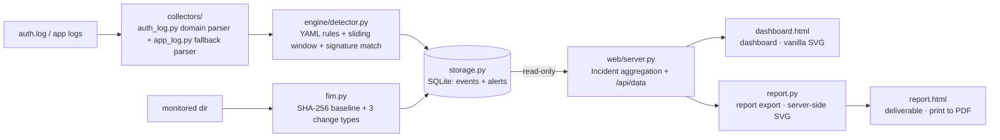

# SentinelWatch — Host Log Auditing & Intrusion Detection Platform

> A lightweight host-based intrusion detection and log auditing platform built on
> the **Python standard library only**: SSH brute-force detection, file integrity
> monitoring (FIM), alert aggregation/deduplication, and a visual dashboard.
>
> **This tool is for analyzing logs and hosts you are authorized to access.
> Deploying or monitoring hosts without authorization is illegal.**

## Core Capabilities

| Module | Capability | Design highlights (interview-ready) |
|---|---|---|
| Collection & parsing | auth.log domain parser + generic app-log fallback parser | Two-layer design: the domain parser yields structured fields (user/ip/port); the fallback parser drops no lines — coverage first, the standard SIEM collector layering |
| Rule engine | YAML declarative rules + sliding windows + thresholds + **signature matching** | **New detection scenario = add one YAML file, no code change**; threshold detection catches behavior patterns (brute force), signature matching catches known attack fingerprints (Log4Shell payloads) — dual-mode, inspired by osquery/Wazuh + Suricata's division of labor |
| FIM | Directory SHA-256 baseline + added/modified/deleted detection | **Hashing instead of mtime** (`touch` can forge mtime, not SHA-256); the baseline must live outside the monitored tree (the CLI enforces this) |
| Alert aggregation | Group alerts into Incidents by (source IP, time window) | Alert-noise reduction + **no member is ever dropped** (explainability is the foundation of a blue-team tool's credibility) |
| Web dashboard | Alert timeline (line chart) + TOP source IPs (bar chart) + Incident view | **Zero third-party dependencies**: stdlib `http.server` + vanilla SVG; demoable on air-gapped networks |
| Report export | One-command standalone HTML security report (server-rendered SVG charts) | Dashboard = "live situational awareness", report = "after-the-fact deliverable" — two consumption forms of the same DB; `@media print` → save as PDF without pulling in reportlab |
| Storage | Single-file SQLite (events + alerts tables) | Events are traceable ("which raw events produced this alert"); composite `(ip, ts)` index backs window queries |

Built-in detection rules (in `rules/`, all declarative YAML):

| Rule | Criterion | Severity |
|---|---|---|
| SSH brute force | Threshold: ≥5 failures from one IP in 5 min | high |
| SSH username enumeration | Threshold: ≥5 Invalid user from one IP in 5 min | medium |
| Log4Shell JNDI payload | Signature: log contains `${jndi:` (CVE-2021-44228) | critical |
| Log4Shell obfuscated variant | Signature: `${lower:j` / `${::-j` nesting bypasses | high |
| Log4Shell JNDI reach | Signature: `com.sun.jndi.ldap.LdapCtx@` residue (JNDI lookup happened) | high |
| Log4Shell deserialization reach | Signature: `com.sun.rowset.JdbcRowSetImpl@` residue (serialized bytes were restored) | high |

## Quick Start

```bash
# No dependencies to install (Python 3.10+; PyYAML is the only import, for rule loading)
pip install pyyaml

# 1. Import logs → run rules → persist alerts
python cli.py import --log tests/sample_auth.log --db sentinelwatch.db --reset

# 2. File integrity monitoring: build a baseline first, rescan after changes
python cli.py fim --dir /path/to/watch --baseline /tmp/fim_baseline.json
#    (modify/add/delete files, then rerun the same command to produce FIM alerts)

# 3. Start the dashboard (binds 127.0.0.1 only by default)
python cli.py serve --db sentinelwatch.db --port 8080
#    then open http://127.0.0.1:8080

# 4. Export an HTML alert report (Ctrl+P in the browser → save as PDF)
python cli.py report --db sentinelwatch.db --out report.html
```

**Application-log detection example** (Log4Shell; the sample's attack lines are
real captures from the `cve-research/` reproduction lab):

```bash
python cli.py import --log tests/sample_app.log --format app --db log4shell.db --reset
# → 2 CRITICAL (${jndi: payload) + 2 HIGH (JNDI lookup / deserialization residues), benign lines stay silent
```

Bundled sample: `tests/sample_auth.log` (22 hand-crafted events: brute-force burst /
slow attempts / username enumeration / normal traffic / CRON noise). Importing it
produces exactly 2 alerts: **SSH brute force (HIGH, 203.0.113.9)** and
**SSH username enumeration (MEDIUM, 192.0.2.66)**, while the slow-attempt IP
(198.51.100.7, 3 attempts over 15 minutes) correctly stays silent.

A sample generated report is at [`reports/demo_report.html`](reports/demo_report.html).

## Architecture & Data Flow




**Why events and alerts are separate tables**: alerts must be explainable and
forensically sound — every alert traces back to the raw events that produced it.
That is a baseline requirement for any auditing system, and the dividing line
between a real tool and a toy.

**Why aggregation and suppression are separate stages**: in-engine `suppress`
handles "the same rule firing repeatedly"; `suppressor.py` handles "correlated
presentation across rules" (a single brute-force campaign that trips both the
brute-force rule and the enumeration rule should surface as one Incident, not two).

**Why two outputs (dashboard + report)**: the dashboard serves whoever is on
shift right now (live, interactive, newest-first); the report serves after-action
review and hand-off (static, printable, severity-ordered). Same DB, same
aggregation (`report.py` reuses `build_api_payload` from `web/server.py` —
a single source of truth, so the two paths can never drift apart).

## Tests

```bash
pytest tests/ -v     # 38 test cases
```

- `test_engine.py` (8): parsing / rule loading / threshold & window boundaries / storage round-trip
- `test_fim_suppressor.py` (9): FIM's three change types + exclusion rules + streaming
  hash correctness; incident aggregation by IP / window splitting / highest-severity
  selection / host-side grouping / ordering
- `test_report.py` (10): full report pipeline / XSS escaping (malicious alert fields
  must never escape) / server-rendered SVG charts / empty-DB degradation /
  zero external references / print styling / CLI subcommand
- `test_log4shell_rules.py` (11): generic log parser (timestamps / IPs / no dropped
  lines) / signature-match operators (AND/OR) / end-to-end Log4Shell rule detection /
  suppression & IP attribution / CLI

**Signature matching (v1.0) semantics**: every substring in `raw_contains` must be
present (AND, narrows the match); any substring in `raw_contains_any` suffices
(OR, variant families). The two operators are explicit — a security rule's matching
condition must be predictable, never convention-based.

## Relationship to Wazuh / osquery (Homage & Differences)

| | SentinelWatch | Wazuh |
|---|---|---|
| Deployment | Single file + SQLite, copy-and-run | Agent + Manager + Elastic stack |
| Rules | YAML declarative, single directory load | XML rules + decoder system |
| Realtime | File import (live agent planned for v1.5) | Live collection |
| Positioning | Learning / demos / small-scale host self-audit | Production enterprise deployment |

The design ideas (baseline + declarative rules + sliding windows + alert
aggregation) pay homage to osquery and Wazuh, while the engineering scale stays
deliberately lightweight — **the goal of this project is to explain the core SIEM
pipeline end-to-end, not to rebuild Wazuh**.

## Disclaimer

For educational use and authorized security analysis only. Collecting logs or
monitoring files on hosts without authorization is illegal; you bear full legal
responsibility for your usage.
