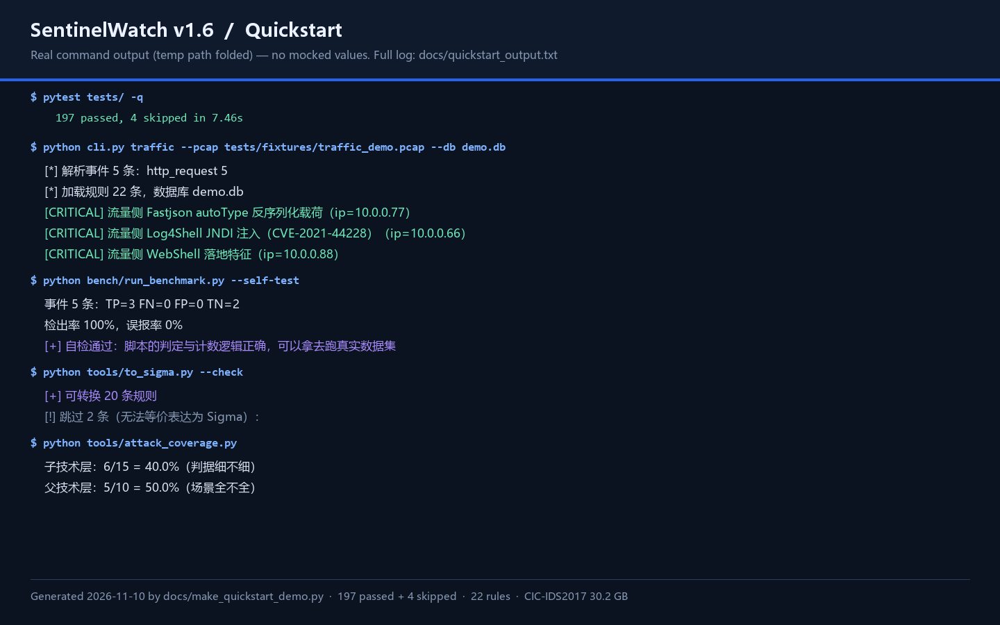
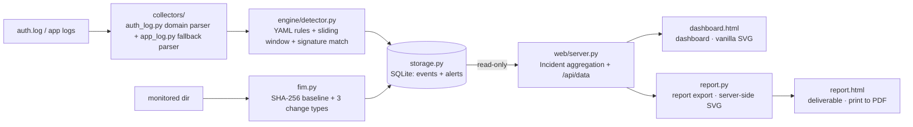

# SentinelWatch — Log & Traffic Intrusion Detection Platform

[](https://github.com/yliucherish/sentinelwatch/actions/workflows/ci.yml)

> A lightweight intrusion detection platform built on the **Python standard
> library only**, with **two data sources (logs + network traffic)**: SSH
> brute-force detection, file integrity monitoring (FIM), PCAP → HTTP
> reconstruction and HTTP-layer attack detection, alert
> aggregation/deduplication, and a visual dashboard.
>
> **v1.7 (2026-11-10)**: closed the "7,181 brute-force requests, 0 hits" gap with a
> **window-frequency rule** for HTTP login endpoints. The threshold is calibrated on
> two all-benign working days first, then validated on the attack day; window alerts
> are evaluated **at alert level**, never merged into the per-request matrix.
> Now **23 rules / 20 exportable to Sigma** (3 threshold rules explicitly refused),
> **207 passed + 8 skipped**. See [`bench/run_frequency.py`](bench/run_frequency.py)
> and `bench/BENCHMARK.md` §2.6.
>
> **v1.6 (2026-11-09, benchmark baseline)**: three full-day CIC-IDS2017 captures
> (30.2 GB, 159,187 HTTP requests) — **4 real false positives out of 150,262**,
> **853/863 = 98.84%** of payload-bearing attacks hit, overall recall 9.56%,
> precision 95.31%. The per-request matrix is **unchanged in v1.7**. Numbers and
> reproduction commands: [`bench/BENCHMARK.md`](bench/BENCHMARK.md); raw reports:
> [`bench/results/`](bench/results/).
>
> **This tool is for analyzing logs, traffic and hosts you are authorized to
> access. Deploying or monitoring hosts without authorization is illegal.**

## Core Capabilities

| Module | Capability | Design highlights (interview-ready) |
|---|---|---|
| Collection & parsing | auth.log domain parser + generic app-log fallback parser + **PCAP traffic reconstruction (v1.2)** | Two-layer design: the domain parser yields structured fields (user/ip/port); the fallback parser drops no lines — coverage first, the standard SIEM collector layering |
| Rule engine | YAML declarative rules + sliding windows + thresholds + **signature matching** | **New detection scenario = add one YAML file, no code change**; threshold detection catches behavior patterns (brute force), signature matching catches known attack fingerprints (Log4Shell payloads) — dual-mode, inspired by osquery/Wazuh + Suricata's division of labor |
| Traffic detection (v1.2) | Hand-written libpcap parser → TCP reassembly → HTTP reconstruction → normalization → reuse the rule engine | **Detection features decoupled from data sources**: all three collectors emit the same event model, so rules/storage/dashboard/report work unchanged. No scapy: 3 link types, both byte orders, ns precision, out-of-order reassembly |
| Web attack detection (v1.5) | SQLi (UNION / boolean blind / time based / metadata probe), XSS, path traversal | **Criteria organised by attack technique, not only by CVE number**: Log4Shell + Fastjson are "two bugs in two components", whereas SQLi/XSS are the everyday shape of web attacks. Criteria always demand explicit injection syntax (`onerror=alert`, not a bare `onerror`; `../../`, not a single `../`) — **better to under-report than to be switched off in week one** |
| Rule standardisation (v1.3 → v1.7) | ATT&CK tags on all **23** rules + **Sigma export (20/23)** | **Judgements can be consumed elsewhere**: Sigma is the common tongue of detection rules. The 3 window-threshold rules are **explicitly refused** rather than silently downgraded to `threshold=1` (better not to convert than to convert wrongly); the coverage denominator is the declared scope, not the whole matrix |
| Behavioural criterion (v1.7) | HTTP login-endpoint frequency threshold over a 60s sliding window | **Signatures ask "what is in this request"; thresholds ask "how many times did this IP do it"**: CIC Thursday's 7,181 brute-force requests carry no injection payload, so a signature rule cannot hit them — that is a missing *criterion type*, not a shortage of regexes. Threshold calibrated on all-benign captures; alert-level evaluation kept separate (§2.6) |
| Public-dataset benchmark (v1.6) | `bench/`: PCAP + labels → per-request confusion matrix + report | **Measure yourself with somebody else's ruler**: three full CIC-IDS2017 captures, recall / false-positive rate / throughput, plus denominator breakdown and FP attribution. Label windows are UTC while event timestamps are local wall-clock — **compare on epoch only**, guarded by four-timezone subprocess tests |
| FIM | Directory SHA-256 baseline + added/modified/deleted detection | **Hashing instead of mtime** (`touch` can forge mtime, not SHA-256); the baseline must live outside the monitored tree (the CLI enforces this) |
| Alert aggregation | Group alerts into Incidents by (source IP, time window) | Alert-noise reduction + **no member is ever dropped** (explainability is the foundation of a blue-team tool's credibility) |
| Web dashboard | Alert timeline (line chart) + TOP source IPs (bar chart) + Incident view | **Zero third-party dependencies**: stdlib `http.server` + vanilla SVG; demoable on air-gapped networks |
| Report export | One-command standalone HTML security report (server-rendered SVG charts) | Dashboard = "live situational awareness", report = "after-the-fact deliverable" — two consumption forms of the same DB; `@media print` → save as PDF without pulling in reportlab |
| Storage | Single-file SQLite (events + alerts tables) | Events are traceable ("which raw events produced this alert"); composite `(ip, ts)` index backs window queries |

Built-in detection rules (in `rules/`, all declarative YAML):

| Rule | Criterion | Severity |
|---|---|---|
| SSH brute force | Threshold: ≥5 failures from one IP in 5 min | high |
| SSH username enumeration | Threshold: ≥5 Invalid user from one IP in 5 min | medium |
| Log4Shell JNDI payload | Signature: log contains `${jndi:` (CVE-2021-44228) | critical |
| Log4Shell obfuscated variant | Signature: `${lower:j` / `${::-j` nesting bypasses | high |
| Log4Shell JNDI reach | Signature: `com.sun.jndi.ldap.LdapCtx@` residue (JNDI lookup happened) | high |
| Log4Shell deserialization reach | Signature: `com.sun.rowset.JdbcRowSetImpl@` residue (serialized bytes were restored) | high |
| Fastjson autoType (traffic) | Signature: body contains `@type` + a known gadget class | critical |
| Log4Shell over HTTP (traffic) | Signature: normalized request contains `${jndi:` | critical |
| WebShell upload (traffic) | Signature: body contains `eval($_POST` / `Runtime.exec(` | critical |
| SQLi · UNION select (traffic) | Signature: `union select` / `union/**/select` | critical |
| SQLi · boolean blind (traffic) | Signature: `' or ` **and** `=1--` / `='1` / `1=1` | high |
| SQLi · time based (traffic) | Signature: `sleep(` / `benchmark(` / `waitfor delay` | high |
| SQLi · metadata probe (traffic) | Signature: `information_schema` / `load_file(` / `into outfile` | high |
| XSS · script tag (traffic) | Signature: `<script` / `<svg onload` / `javascript:alert(` | high |
| XSS · event handler (traffic) | Signature: `onerror=alert` / `onload=alert` | medium |
| Path traversal (traffic) | Signature: `../../` / `/etc/passwd` / `..\..\` | high |

> The v1.5 group exists because **measuring against a public dataset made the gap
> obvious**: CIC-IDS2017's web attacks are SQLi / XSS / form brute force, while the
> then-13 rules were all Log4Shell(2021) / Fastjson / WebShell — not one of them could
> fire. The lesson: **organise criteria by attack technique, not only by CVE number.**
> See [`bench/DATASETS.md`](bench/DATASETS.md).

## Quick Start

```bash
# No dependencies to install (Python 3.10+; PyYAML is the only import, for rule loading)
pip install pyyaml

# 1. Import logs → run rules → persist alerts
python cli.py import --log tests/sample_auth.log --db sentinelwatch.db --reset

# 1.5 Traffic detection (v1.2): PCAP goes into the same DB and the same rule engine
python cli.py traffic --pcap tests/fixtures/traffic_demo.pcap --db sentinelwatch.db
# → 8 packets → 5 HTTP requests → 3 CRITICAL (Log4Shell / Fastjson / WebShell)
#   the demo PCAP is synthesized by tools/pcapgen.py (valid checksums, opens in Wireshark)

# 2. File integrity monitoring: build a baseline first, rescan after changes
python cli.py fim --dir /path/to/watch --baseline /tmp/fim_baseline.json
#    (modify/add/delete files, then rerun the same command to produce FIM alerts)

# 3. Start the dashboard (binds 127.0.0.1 only by default)
python cli.py serve --db sentinelwatch.db --port 8080
#    then open http://127.0.0.1:8080

# 4. Export an HTML alert report (Ctrl+P in the browser → save as PDF)
python cli.py report --db sentinelwatch.db --out report.html
```

**30-second demo**: every line below was captured from five commands that
[`docs/make_quickstart_demo.py`](docs/make_quickstart_demo.py) actually runs — no
hand-written or mocked values. The unabridged output is kept in
[`docs/quickstart_output.txt`](docs/quickstart_output.txt) for line-by-line
verification (only the random temp path is folded to `demo.db` in the image).



**Application-log detection example** (Log4Shell; the sample's attack lines are
real captures from the `cve-research/` reproduction lab):

```bash
python cli.py import --log tests/sample_app.log --format app --db log4shell.db --reset
# → 2 CRITICAL (${jndi: payload) + 2 HIGH (JNDI lookup / deserialization residues), benign lines stay silent
```

Bundled sample: `tests/sample_auth.log` (22 hand-crafted events: brute-force burst /
slow attempts / username enumeration / normal traffic / CRON noise). Importing it
produces exactly 2 alerts: **SSH brute force (HIGH, 203.0.113.9)** and
**SSH username enumeration (MEDIUM, 192.0.2.66)**, while the slow-attempt IP
(198.51.100.7, 3 attempts over 15 minutes) correctly stays silent.

A sample generated report is at [`reports/demo_report.html`](reports/demo_report.html).

## Architecture & Data Flow




**Why events and alerts are separate tables**: alerts must be explainable and
forensically sound — every alert traces back to the raw events that produced it.
That is a baseline requirement for any auditing system, and the dividing line
between a real tool and a toy.

**Why aggregation and suppression are separate stages**: in-engine `suppress`
handles "the same rule firing repeatedly"; `suppressor.py` handles "correlated
presentation across rules" (a single brute-force campaign that trips both the
brute-force rule and the enumeration rule should surface as one Incident, not two).

**Why two outputs (dashboard + report)**: the dashboard serves whoever is on
shift right now (live, interactive, newest-first); the report serves after-action
review and hand-off (static, printable, severity-ordered). Same DB, same
aggregation (`report.py` reuses `build_api_payload` from `web/server.py` —
a single source of truth, so the two paths can never drift apart).

## Tests

```bash
pytest tests/ -q
# 207 passed, 8 skipped (215 collected; wall time varies by machine)
# Windows figures: 7 of the 8 skips are TZ-subprocess cases that Windows ignores;
# on Linux / CI they run and count as passed. The 8th needs optional `sigma`.
```

| Test file | Cases | What it guards |
|---|---:|---|
| `test_engine.py` | 9 | Rule loading / threshold & window boundaries / storage round-trip |
| `test_fim_suppressor.py` | 8 | FIM's three change types + exclusions + streaming hash / incident aggregation |
| `test_report.py` | 9 | Full report pipeline / XSS escaping / server-rendered SVG / print styling |
| `test_log4shell_rules.py` | 12 | Generic log parser / AND-OR operators / four rules end-to-end / IP attribution |
| `test_fastjson_rules.py` | 12 | Six Fastjson rules / three bypasses line by line / suppression semantics |
| `test_ioc.py` | 21 | Five IOC types / domain-suffix boundaries / hit counts / true negatives |
| `test_pcap.py` | 29 | Endianness / ns precision / three link types / **native pcapng + `if_tsresol`** / out-of-order TCP reassembly / keep-alive / server responses and UDP produce no events / **streaming equals full-load** / corrupt frames rejected |
| `test_sigma_export.py` | 33 | Tags on all **23** rules / threshold rules must be refused / AND-OR mapped to `all of` and `1 of` / sample-by-sample equivalence / deterministic UUIDs / official pySigma parses the output |
| `test_web_attack_rules.py` | 44 | Four SQLi families / two XSS / path traversal true positives + 12 true-negative near-misses / end-to-end PCAP / **a threshold rule's `match` is a filter, not a verdict** |
| `test_bench_selftest.py` | 7 | Four-timezone subprocess regression (UTC / Shanghai / New York / Berlin) |
| `test_bench_labels.py` | 18 | "Config" values that are actually measured conclusions: ADT offset 3, NAT'd attacker IP, epoch comparison, window + IP conjunction, `by_shape` breakdown, recall upper bound |
| `test_frequency.py` | 13 | Frequency-rule selection / closed sliding-window boundary / alert-level TP-FP / alerts on all-benign data must count as FP / no alert above threshold / **four-timezone window overlap** |

**Timezone regression must include a non-UTC zone**: label windows are UTC while
event timestamps are naive wall-clock rendered by the collector's local
`datetime.fromtimestamp()`. Both sides are compared on epoch. This bug bit twice
(TP=0 on CI, and `TP 0 FN 0 FP 895` on the first real-dataset run) and passes by
coincidence on a UTC machine — hence four subprocesses, not one.

**Signature matching (v1.0) semantics**: every substring in `raw_contains` must be
present (AND, narrows the match); any substring in `raw_contains_any` suffices
(OR, variant families). The two operators are explicit — a security rule's matching
condition must be predictable, never convention-based.

## Public-Dataset Benchmark (`bench/`)

A hand-made 8-packet sample proves the code runs; it says nothing about whether the
detector is any good — **setting your own exam means you always score 100%**. So
there is `bench/`:

```bash
python bench/run_benchmark.py --self-test     # verify the harness (no dataset needed)
python bench/run_benchmark.py --pcap data/x.pcap \
    --labels bench/labels/cic_ids2017_thursday_web.json --out out/
```

Three numbers: **recall / false-positive rate / throughput**, each reproducible by a
command. The labelling rule is declared explicitly — the dataset labels flows while
this tool emits per-request events, so instead of using the shipped labels we use
「attack time window + attacker source IP」 and print that rule verbatim in the report
so anyone can re-check it.

**Status: done.** Three full-day CIC-IDS2017 captures (Monday / Tuesday / Thursday,
30.2 GB, **159,187 HTTP requests**) have been measured end to end. Per-request
details live in `out/bench_*.csv`; all numbers and reproduction commands are in
[`bench/BENCHMARK.md`](bench/BENCHMARK.md).

| Metric | Measured |
|---|---|
| Real false positives | **4 / 150,262 benign requests (0.0027%)** |
| Thursday requests carrying a payload | **853 / 863 = 98.84% detected** |
| Overall recall | **9.56%** (853/8,925) — denominator includes 8,062 payload-free requests, see below |
| Precision | **95.31%** |
| Throughput | 60–97 MB/s single-threaded (varies with disk cache; no cherry-picking) |

**The 9.56% needs explaining.** The labelling rule counts *every* HTTP request the
attacker host emitted during the attack windows as a positive, yet 8,062 of those
are `POST /dv/login.php` credential attempts or bare `GET /xss_r/` page loads with
**no query string at all**. Signature rules only fire on payloads by design.
Splitting by a purely syntactic criterion (whether the URI has a non-empty query,
independent of any rule) shows 853 of 863 payload-bearing requests detected. That
table **explains** the headline number; it does not replace it.

**Known limits are documented, not hidden**: (1) all 7,181 form brute-force requests
went undetected — signatures cannot see "one IP tried 500 accounts in five minutes",
which needs threshold rules plus response codes, and the current parser only reads
the client direction; (2) all 4 real false positives are `POST /ar.logger.php` ad-bidding logs whose URL-encoded ad HTML contains `<script>` — *without*
normalisation encoded XSS bypasses everything, *with* it legitimate rich text looks
like an attack, and whitelisting that URI would merely memorise the dataset, so the
rule was left unchanged; (3) only HTTP is reassembled, so Tuesday's FTP/SSH brute
force produces zero events — a data-source coverage issue, not a detector bug.

**The work paid for itself beyond the numbers**: real captures exposed four bugs no
synthetic sample could catch — reading the whole file into memory, the official
`.pcap` actually being pcapng, buffering the detail CSV in RAM, and finally the
*labelling window being UTC while event timestamps were local wall-clock*. The last
one was the sneakiest: Thursday's first run reported `TP 0 FN 0`, looking like a
completely useless detector, when in fact an 8-hour offset had turned 894 genuine
detections into false positives. The fix was **not** to bake the local timezone into
the offset, but to compare on epoch, guarded by subprocess tests across four
timezones (non-UTC ones are mandatory — the old code happened to pass on UTC).

**Changing the ruler is how you find out how long your sword actually is.**

## ATT&CK Coverage & Sigma Export (v1.3)

### Coverage: the denominator is the declared scope

Claiming "I cover ATT&CK" carries no information — the enterprise matrix has 200+
techniques, so any single-purpose detection project lands under 1%, a number that is
neither honest nor actionable. The denominator here is the **declared detection
scope**: techniques the three data sources (auth logs / app logs / HTTP traffic) plus
FIM can see in principle — 15 of them.

| Granularity | Covered | Total | Rate | What it measures |
|---|---|---|---|---|
| Sub-technique | 6 | 15 | **40.0%** | how fine-grained the judgement is |
| Parent technique | 5 | 10 | **50.0%** | how complete the scenarios are |

Covered: T1110 / T1110.001 (brute force), T1087 (account discovery), T1190 (exploit
public-facing app, 12 rules), T1059 (command execution), T1505.003 (web shell).

The 9 uncovered ones are not oversights — each carries a note on exactly what is
missing (see the backlog table in [reports/attack_coverage.md](reports/attack_coverage.md)).
**T1087.001 is merely a tagging gap** (the capability exists, the rule lacks the
sub-technique tag); **T1046 / T1041 / T1071.001 need entirely new judgement types** —
half-open connection counting, egress byte aggregation, beacon interval variance.
Conflating those two kinds of gaps is how a "coverage report" turns into
self-congratulation.

```bash
python tools/attack_coverage.py                        # console table
python tools/attack_coverage.py --md reports/attack_coverage.md
python tools/attack_coverage.py --json                 # machine-readable
```

Coverage is **derived dynamically from the `attack.*` tags** in the rule files, not a
hand-copied number: drop a tag and the figure falls immediately. That is what makes
the report live — and safe to wire into CI.

### Sigma export: making the judgements consumable elsewhere

Sigma is the lingua franca of detection rules (what YARA is to files, Snort to
traffic). A rule that converts to Sigma can be consumed by Splunk / Elastic / Sentinel
/ QRadar directly — the lowest bar for "this logic can circulate in the community".

```bash
python tools/to_sigma.py                    # → sigma/ (20 rules)
python tools/to_sigma.py --check           # list convertible / refused rules, write nothing
python tools/to_sigma.py --cased           # strictly case-equivalent variant
sigma check sigma/                          # official validator (pip install sigma-cli)
```

**Result: 20 converted, 2 explicitly refused, official validation reports 0 errors,
0 condition errors, 1 low-severity issue.** (That `EscapedWildcardIssue` is
**intentional**: the `*` in `union/**/select` must match literally and has to be
escaped, otherwise Sigma reads it as a wildcard — see point 4 below.)

Conversion is semantic alignment, not format translation. Four places where cutting
corners would be fatal:

1. **Threshold rules cannot be expressed.** Sigma has no native "N times within a
   window" syntax (that belongs to SIEM-side correlation). So `ssh-brute-force` and
   `ssh-user-enumeration` raise `NotConvertible` with a reason instead of quietly
   emitting a `threshold=1` rule — such a rule would flood the queue in production,
   which is worse than having no rule. **Better not to convert than to convert wrong.**
2. **AND must be split across selections.** In Sigma a list under one key means OR,
   so `raw_contains` (AND) becomes `selection_all_1/2/...` + `all of selection_all_*`,
   while `raw_contains_any` (OR) becomes `1 of selection_any_*`. This is the easiest
   place to turn AND into OR, and `test_sigma_export.py` guards it with a case where
   **dropping one AND literal must not match**.
3. **Wildcards must be escaped.** In Sigma's `|contains`, `*` and `?` are wildcards.
   The literal `union/**/select` (the classic way to break up a WAF keyword) written
   out verbatim reads as "union/ anything /select" — **silent semantic drift, more
   dangerous than a hard error**. The converter therefore escapes `\`, `*` and `?`
   (`_escape_literal`), producing `*union/\*\*/select*`. The official validator leaves
   one low-severity `EscapedWildcardIssue` asking you to confirm the escape is
   deliberate — it is.
4. **Case semantics differ.** The engine's `raw_contains` is case-**sensitive**; Sigma's
   `|contains` is not by default. The default export is therefore looser than the
   source rule, and `--cased` emits `|contains|cased` for strict equivalence. Tests
   assert "engine hit ⇒ Sigma hit" (looser is acceptable, a miss is not) rather than
   bidirectional equality — that is the line drawn between the two.

**Two real spec details fixed along the way** (both caught by the official validator,
not by reading docs):

- `cve.2021.44228` ❌ → `cve.2021-44228` ✅: pySigma's CVETagValidator uses
  `^\d+-\d+$`, so **CVE tags take a hyphen**. The initial version failed all 11 rules
  with `InvalidPatternTagIssue`.
- `sigma check` fetches **MITRE ATT&CK data plus four SigmaHQ JSON files**
  (filename / taxonomy / windows_eventid / windows_provider) at runtime. If any URL
  fails it raises `RuntimeError` and **kills the job** instead of reporting an issue —
  observed on 2026-11-09 while fixing SigmaHQ PR #6561. Offline, `-x attacktag` is
  not enough; pre-seed the caches at `~/.cache/pysigma/mitre_attack` and
  `~/.cache/pysigma/sigmahq`.

## Relationship to Wazuh / osquery (Homage & Differences)

| | SentinelWatch | Wazuh |
|---|---|---|
| Deployment | Single file + SQLite, copy-and-run | Agent + Manager + Elastic stack |
| Rules | YAML declarative, single directory load | XML rules + decoder system |
| Realtime | Offline file import + PCAP batch processing (no live agent) | Live collection |
| Positioning | Learning / demos / small-scale host self-audit | Production enterprise deployment |

The design ideas (baseline + declarative rules + sliding windows + alert
aggregation) pay homage to osquery and Wazuh, while the engineering scale stays
deliberately lightweight — **the goal of this project is to explain the core SIEM
pipeline end-to-end, not to rebuild Wazuh**.

## Disclaimer

For educational use and authorized security analysis only. Collecting logs or
monitoring files on hosts without authorization is illegal; you bear full legal
responsibility for your usage.
